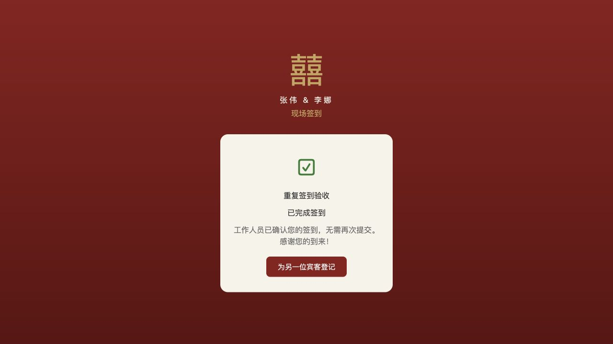
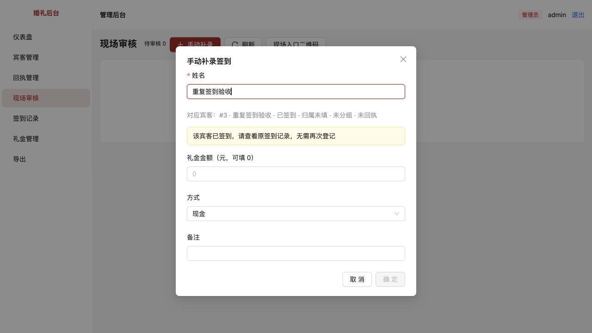

# 第 3 项：确认后重复扫码／补录不能重复记到场和礼金

> 已归档（2026-10-23）：仅保留当时的方案、进度和验收证据，已停止更新，不作为当前需求或待办。请先查阅[现行文档](../../../../README.md)。

[文档索引](../../../../README.md) · [问题目录](../README.md) · [原始审查报告](../../评审/代码审查与现场审核改进建议.md)

完成日期：2026-10-15。

规则修正：[现场临时宾客重名无法登记](../现场临时宾客重名无法登记/README.md)补充了现场新建同名宾客入口。以下验收标准已同步更新；原截图与自动验证段保留第3项初次完成时的记录。

包含这条流程必需的事务与并发保护，对应原报告第4、5项的签到审核部分。

## 原问题怎么复现

1. 使用一个唯一的测试姓名，在 `/checkin` 自助提交。
2. 工作人员在现场审核确认，登记600元测试礼金。
3. 刷新自助页，重新输入相同姓名再提交。
4. 修复前会新增待审核记录，再次确认后，签到和600元礼金都会多一份；手动补录相同宾客也能再次创建已确认签到。
5. 同名宾客的自助提交之前虽不会自动串档，但同一人的网络重试与真实另一位同名宾客无法区分；另一个待审被误选到已签到宾客时也能重复确认。

## 这次改了什么

- 自助登记按本次提交标识返回原记录；同一标识已确认时显示“已完成签到”，待审核时返回原待审。新标识即使同名也创建独立待审，最终按工作人员选择的宾客ID防止重复确认。
- 页面在提交前保留本次标识，弱网重试、浏览器允许本地存储时的页面刷新可复用。只有点击“为另一位宾客登记”或改成另一个姓名才开始新的登记；提交中输入框与重复点击保护避免串操作。
- 同名档案不靠姓名合并：每位的独立提交仍可进入待审。同一标识重试只返回自己的记录；工作人员选中已签到宾客时，界面禁选且后端拒绝，不再增加签到与礼金。
- 手动补录的同一次请求重试返回原结果；主动重新补录同一个已签到宾客会被拒绝；如果确是另一位同名临时宾客，可在现场选择新建。如果已有对应宾客的自助待审，提示先审核原记录。需追加礼金，由管理员在礼金管理单独登记，不通过重复签到实现。
- 签到、散客建档、礼金和提交结果映射放入同一个写事务。写入礼金失败整体回滚；请求体读取完成后才进入事务重新校验状态，状态更新还必须命中pending，避免延迟的旧请求再次确认。
- 提交标识使用随机UUID，数据库只保存其摘要与请求内容摘要。相同标识改变姓名、金额或入口会明确冲突，不静默覆盖第一份结果。
- 签到确认的备注会保存到签到记录，0元时也保留；审核与补录入口校验金额为整数分、合法方式与备注长度，金额上限100000元，前端显示两位小数。
- 保存后刷新签到、候选、礼金、宾客详情与统计缓存；同名候选继续显示各自签到状态。

## 只看页面如何验收

重启 `pnpm dev`，后端自动执行新增迁移；刷新仍开着的签到页和审核页即可。无需手动生成迁移或查看数据库。建议按[本地开发与验收](../../../../技术/本地开发与验收.md)使用独立验收数据库，避免测试礼金影响正式账本。

| 操作 | 预期结果 |
| --- | --- |
| 唯一测试姓名自助提交→后台确认，记600元 | 签到记录1条，礼金管理1笔600元 |
| 刷新自助页，再提交同名 | 显示该姓名和“已完成签到”，后台不新增待审 |
| 点击“为另一位宾客登记”，仍输入相同姓名 | 创建独立待审，工作人员核对已有宾客或新建另一位同名宾客；不会直接记账 |
| 后台手动补录已签到姓名 | 已签到候选不可选择；如确为另一人，可选择新建并填写辨识分组 |
| 先自助提交另一个姓名但不审核，再手动补录这个姓名 | 提示先处理待审原记录，不新增已确认记录 |
| 预先建两位同名档案（不同归属/分组），分别自助登记 | 两位都能进入待审；同一浏览器替第二位登记需点击“为另一位宾客登记” |
| 确认第一位后，打开另一条同名待审 | 第一位显示已签到且不能选，第二位仍可选并正常确认 |
| 检查第一位宾客的签到记录与礼金管理 | 该宾客ID仍仅1条已确认签到、1笔600元；新标识可多一条待核对提交 |

只有一个同名档案、实际却有两位不同宾客时，工作人员可直接在现场审核或手动补录选择“都不是，新增另一位同名宾客”，填写辨识分组，无需提前去宾客管理建档。清空存储或换设备会使用新标识，可能再次进入待审；最终确认仍按宾客ID拦截重复签到。

历史重复签到与礼金保持原样，本次不自动删除、合并或修正旧总额；已确认礼金的删除与作废权限仍属于后续整改。

## 自动验证与浏览器结果

新增13个回归场景：确认后原标识/新标识重试、待审期间重复提交、同名重试与分别登记、手动同次重试与主动重复、已有待审时补录、先补录后扫码、同标识改载荷冲突、并发自助、延迟请求体并发确认、审核写失败回滚、补录写失败全链路回滚、非法标识拒绝、历史重复不改动且优先返回已确认记录。修改前12项失败、1项通过，修改后13项通过；加上原测试共40项通过。类型检查及生产构建通过。

浏览器使用独立临时数据库：自助提交“重复签到验收”→审核600元→刷新再提交，看到“已完成签到”；后台待审仍为0，手动补录同名显示已签到且确定禁用。独立库核对仍为1条签到、1笔60000分礼金。未把测试数据写入正常业务库。

迁移仅新增提交映射表（0002），不改已有签到/礼金。历史记录没有提交映射也会按guestId检查；映射表外键在对应签到被删除时一并清理，原有驳回行为仍可使用。

