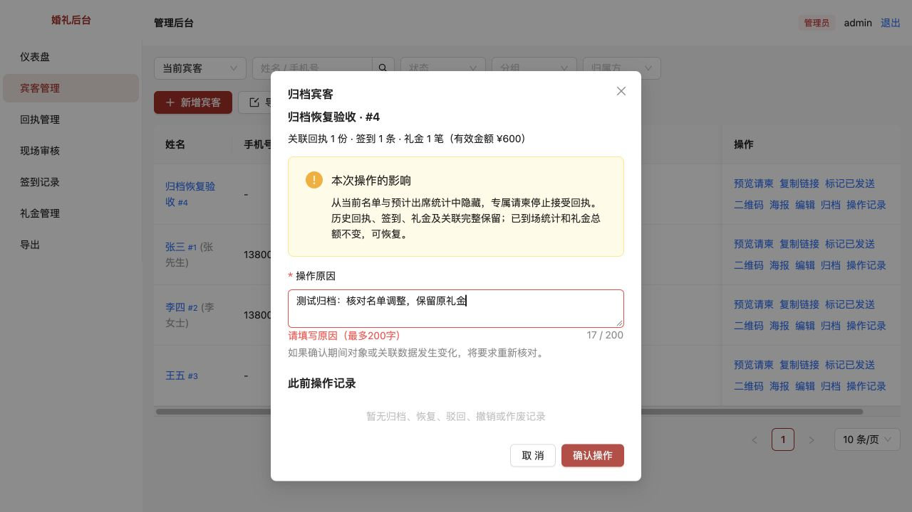
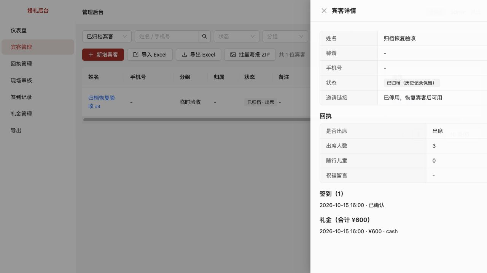
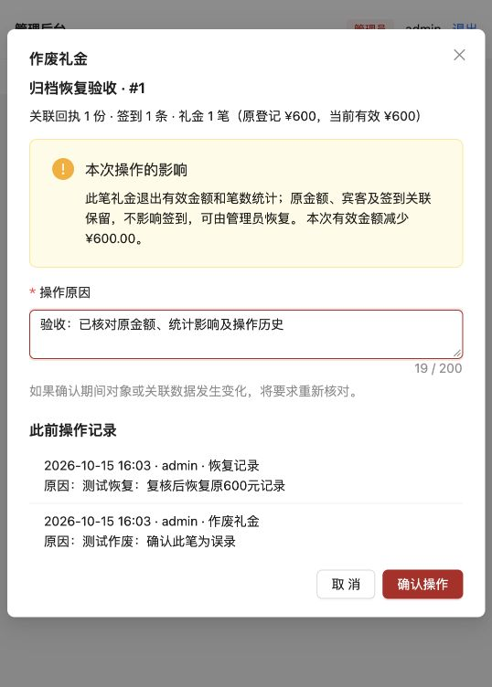
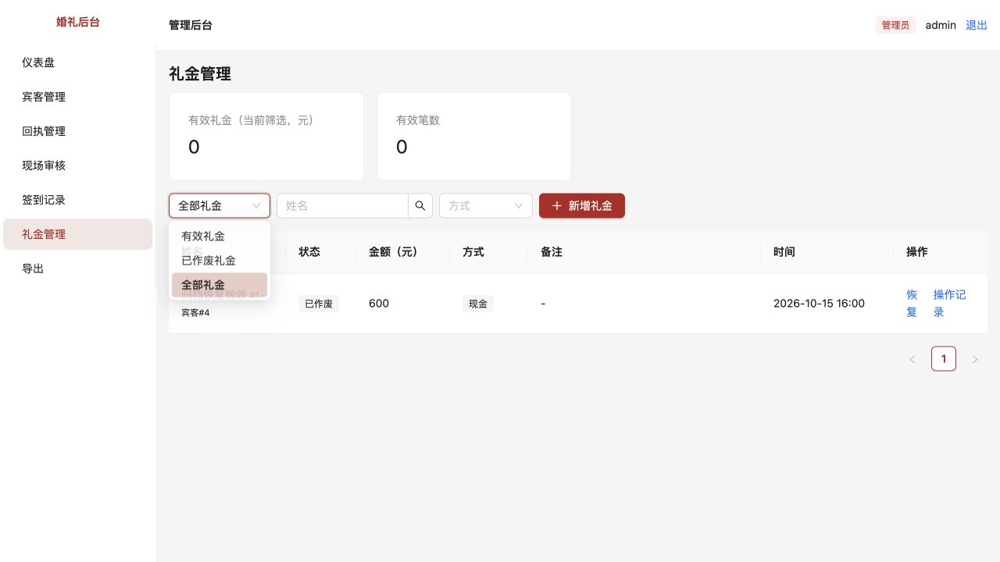
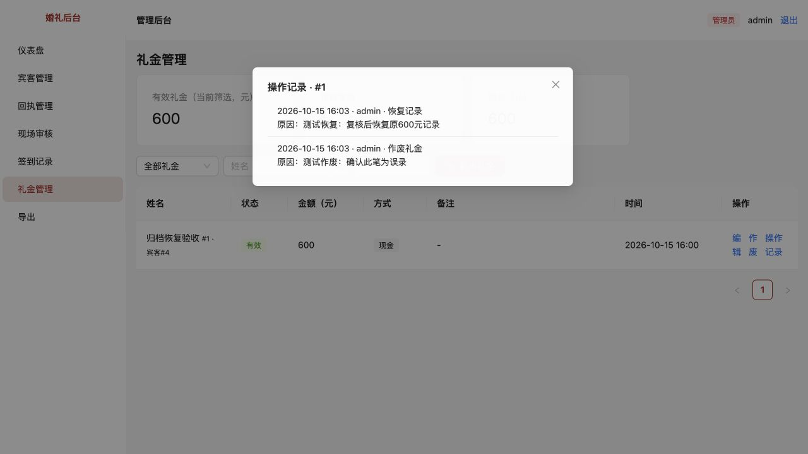
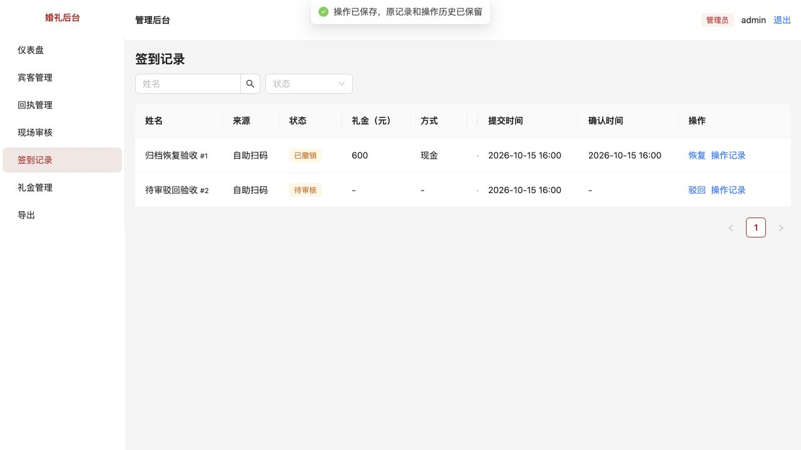
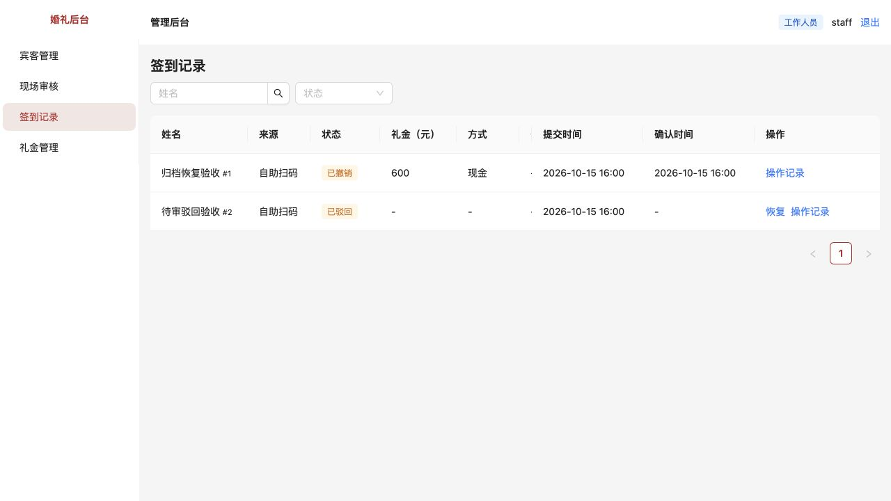

# 第6项：删除改为可追溯业务操作

> 已归档（2026-10-23）：仅保留当时的方案、进度和验收证据，已停止更新，不作为当前需求或待办。请先查阅[现行文档](../../../../README.md)。

[文档索引](../../../../README.md) · [问题目录](../README.md) · [统一业务规则](../../../../产品/数据操作与保留规则.md) · [准备验收环境](../../../../技术/本地开发与验收.md)

完成日期：2026-10-15。已修复并通过自动测试与浏览器验证，用户验收通过。本次覆盖项目全部3个删除入口；同时补齐礼金作废及相关状态操作审计。第4项先前的“删除并解除关联”规则从本项起废止。

## 原问题怎么复现

- 宾客管理删除一位有回执、签到和礼金的宾客：回执被删除，签到与礼金的宾客ID被清空，后续难以区分同名宾客的账目。即使删除流程有事务，业务损失仍不可恢复。
- 工作人员直接请求删除已确认签到：原接口只检查已登录，会连带删除关联礼金，绕过礼金删除仅管理员的限制。
- 管理员在礼金管理点击删除：金额、记录与关联被物理删除，没有作废原因和可恢复的原记录。
- 原确认框没有清楚列出关联影响，也不防止确认期间另一位操作者修改数据。

## 已实现的操作

| 原入口 | 当前入口 | 可恢复与权限 |
| --- | --- | --- |
| 宾客删除 | 归档 | 管理员归档／恢复，保留全部关联 |
| 待审驳回即删除 | 驳回并保留原提交 | 管理员／工作人员驳回；可恢复待审 |
| 删除已确认签到 | 撤销确认 | 仅管理员；恢复原确认不重复记礼金 |
| 礼金删除 | 作废 | 仅管理员；保留原金额，可恢复 |

所有操作先展示姓名、编号、关联数量、原登记金额、当前有效金额和影响说明，再填写原因。后端在写事务内重新检查状态和数据快照；迟到确认、重复请求、权限不足均不能绕过。状态与审计一起保存，任一步失败整体回滚。旧DELETE接口统一关闭。

列表增加当前／已归档宾客、有效／已作废／全部礼金筛选。签到保留已驳回、已撤销记录，并提供恢复及操作记录入口。各页面修改后同步刷新相关缓存。

## 如何验收

重启 `pnpm dev`，刷新后台页面；启动自动执行0003迁移，**无需重新初始化或重置账号**。建议使用[独立验收库](../../../../技术/本地开发与验收.md)。

### 宾客归档与恢复

1. 新建测试宾客，通过专属请柬填出席3人，再确认其签到并登记600元测试礼金。
2. 宾客管理点“归档”：确认框应显示宾客编号、1份回执、1条签到、1笔礼金和600元。留空原因不能提交。
3. 填原因确认：当前名单不再显示，切换“已归档宾客”可找到。详情仍有3人回执、原签到和600元礼金，专属链接停用；预计出席减少，礼金总额不变。
4. 点击恢复并填原因：原宾客回到当前名单，专属请柬恢复；编号和关联不变，礼金不会翻倍。

### 礼金作废与恢复

1. 管理员在礼金管理点击这笔600元的“作废”，确认框应明确显示有效金额将减少600元，签到不受影响。
2. 填原因确认：有效金额减少600元；切换“全部礼金”仍看到原金额600元、已作废状态，且不能直接编辑。
3. 点恢复、填原因：原记录回到有效状态，有效金额恢复600元，不产生第二笔。
4. 点操作记录：能看到作废和恢复的操作者、原因及时间。

### 驳回与撤销

1. 自助提交另一测试姓名，工作人员在现场审核点驳回，核对影响并填原因。
2. 待审消失，但签到记录中仍能看到“已驳回”、原因历史和恢复入口；恢复后回到待审，不能直接变成已确认。
3. 管理员在签到记录中对已确认记录点“撤销确认”：填原因后变为已撤销，到场统计减少，600元礼金仍然有效。
4. 管理员恢复原确认：到场统计恢复，礼金不新增。若宾客已归档或已有另一条有效签到，应被阻止并提示先核对。
5. 切换staff：没有宾客归档、礼金作废、已确认签到撤销或已撤销签到恢复权限；仍可驳回待审、恢复已驳回提交并查看签到操作记录。

### 确认期间数据变化

两个窗口打开同一记录。其中一个窗口打开操作确认框后，另一个窗口修改关联礼金或先完成操作。第一个窗口再确认时必须提示对象或关联已变化，不能用旧确认继续写入；页面重新展示最新影响后，再由操作者核对。

## 自动验证与兼容性

```bash
pnpm test
pnpm typecheck
pnpm build
```

新增 `tests/lifecycle.test.ts` 共12项，覆盖归档与恢复、作废与恢复、角色及旧接口拦截、撤销不影响礼金、驳回重试与恢复、必填原因及快照过期、重复确认与恢复冲突、审计失败回滚、已归档宾客保护、导出状态与原／有效金额、旧数据库迁移保留关联、迟到编辑不能改写归档档案。第4项的原删除断言已调整为归档与完整保留规则。

全项目66项测试通过，类型检查和生产构建通过。构建仍有现有的大图表分块提示。

浏览器使用独立临时数据库与3195端口：归档及恢复同一宾客、留空原因拦截、3人回执与600元关联保留、礼金作废后有效金额0且原600元仍可查、恢复仅一笔600元、撤销签到保留礼金、驳回保留原提交、操作历史、工作人员入口限制均已验证。未向正常业务库写入测试数据。

## 验收截图
















## 当前范围

本次未提供任何永久删除入口，包括无关联的空档案也统一归档；不提供自动合并或批量清理。旧版已物理删除或已解除关联的数据不能靠本次迁移自动找回。本次新增操作历史覆盖上述状态操作，普通编辑的完整审计与收款核对继续按后续计划处理。
