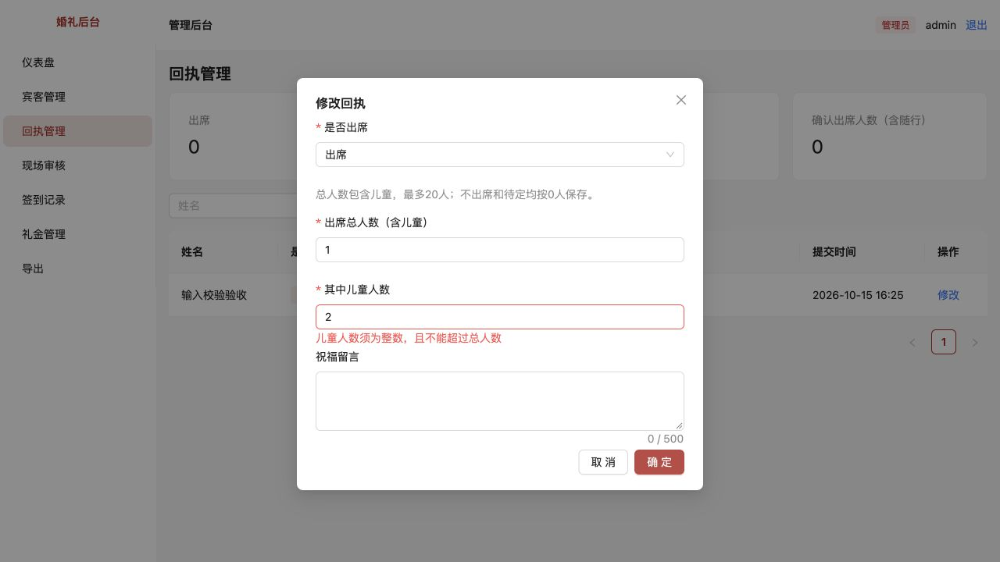
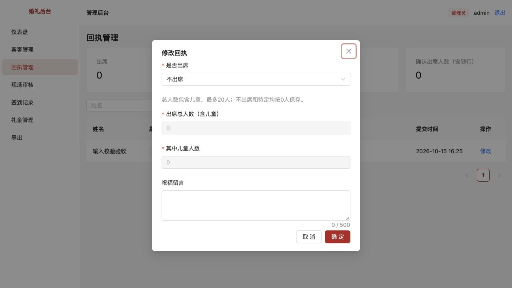
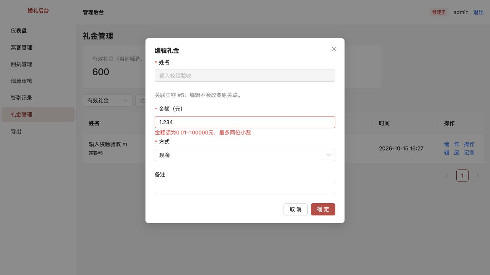
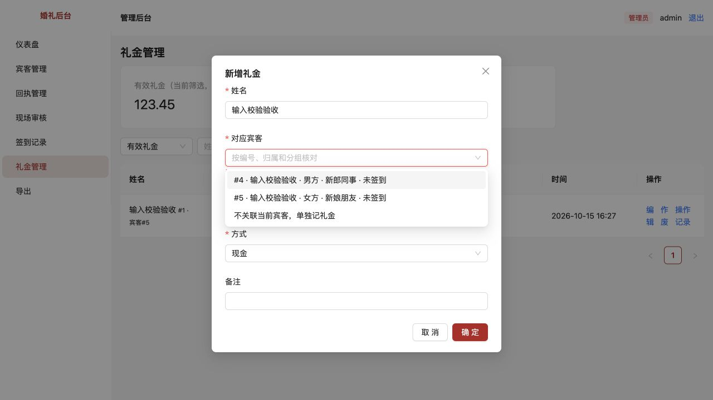
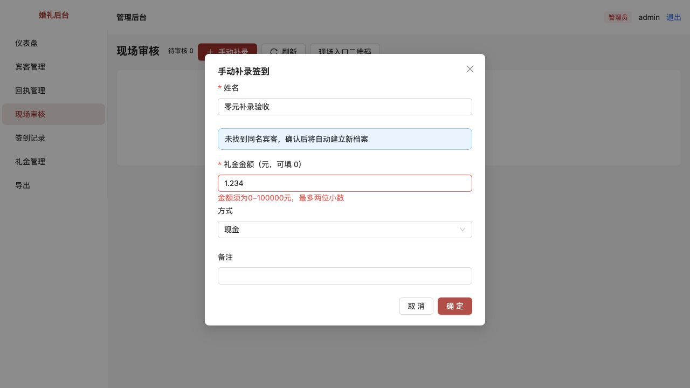

# 第7项：输入校验与关联核对

> 已归档（2026-10-23）：仅保留当时的方案、进度和验收证据，已停止更新，不作为当前需求或待办。请先查阅[现行文档](../../../../README.md)。

[文档索引](../../../../README.md) · [问题目录](../README.md) · [验收环境](../../../../技术/本地开发与验收.md)

完成日期：2026-10-15。已修复并通过自动测试、类型检查、构建和浏览器验证，待用户验收。本项覆盖剩余回执、礼金、宾客写入校验及列表分页、筛选与记录编号校验。

## 原问题怎么复现

1. 专属请柬接口提交小数人数、非法出席状态、儿童人数大于总人数，原接口会保存。后台修改回执也能写入这些值；不出席仍能留存非零人数。
2. 礼金接口提交 `amount: null`、数字字符串、负数修改或小数分，原实现依赖Number转换或强制归零；可保存零元或异常记录。伪造宾客ID或不同姓名的ID也没有被核对。
3. 宾客新增／编辑只检查非空姓名，非法归属方、超长字段或非字符串资料可能被忽略或保存。Excel导入会把未知归属静默变成空值。
4. 列表的非整数页码、Infinity等参数可能进入数据库查询；无效枚举和编号缺少统一错误提示。
5. 浏览器额外复现：旧数字控件先填600，再改成越界的0，界面显示0但可能仍提交缓存中的600。仅加服务器范围校验无法识别这种前端旧值提交。

异常请求复现和数据未被修改的断言已保存在 `tests/input-validation.test.ts`，全部使用临时数据库，不向业务库发送异常请求。

## 修改内容

- 专属、通用与后台回执共用规则：出席人数为1–20整数，儿童为0–20整数且不超过总人数；不出席、待定按0人保存。后台部分修改先合并原值再校验，单改总人数不能自动清掉儿童数。
- 礼金账目金额必须为1–10000000整数分，即0.01–100000元；方式只能为现金、微信或支付宝。拒绝空值、布尔值、数字字符串、小数分、负数及超限值，不再静默转换。
- 礼金关联宾客时，后台核对该ID真实存在且姓名一致；未选择ID的独立礼金保持独立，不按姓名猜测。编辑不允许改名、改绑宾客或直接改作废状态。
- 新增礼金出现同名候选时必须明确选择编号，或主动选择“不关联当前宾客，单独记礼金”。候选显示归属、分组与签到状态，追加礼金可选择已签到者。
- 宾客手动录入和Excel导入共用姓名、资料长度、归属方校验；错误导入行显示行号及原因，合法行仍可导入，数据库写入错误的整批回滚规则保留。损坏文件返回400而非服务异常。
- 页码、每页条数和记录编号须为有限正整数；每页上限仍为100；无效筛选枚举返回400。字段之外的状态、邀请凭证、归档或作废等受保护字段不能通过普通编辑修改。
- 金额及后台人数改为直接输入文本并严格解析，不使用数字控件缓存，不自动截断、四舍五入或复用旧值。123.45元按整数分精确得到12345分。
- 现场审核、手动补录共用同一金额解析；此处允许0表示本次未记礼金，不创建零元账目。原有同名核对、重试保护和归档／作废权限继续保留。
- 没有数据库迁移，也不清洗或重写历史记录。

## 当前边界

| 字段 | 规则 |
| --- | --- |
| 回执姓名／宾客姓名／独立礼金姓名 | 1–50字，去除首尾空白 |
| 现场签到姓名 | 沿用1–30字 |
| 称谓、电话 | 最多30字；电话不强制为国内手机号 |
| 分组 | 最多50字 |
| 留言、备注 | 最多500字 |
| 回执总人数 | 出席1–20整数；不出席／待定0 |
| 儿童人数 | 整数，不超过总人数 |
| 礼金账目 | 0.01–100000元，最多两位小数 |
| 签到时记礼金 | 0–100000元，0表示不记礼金 |

## 页面验收

重启 `pnpm dev` 并刷新页面，无需迁移或重新初始化账号。建议使用[独立验收库](../../../../技术/本地开发与验收.md)。

### 回执人数

1. 测试回执选择出席，总人数填1、儿童填2，点击保存：应提示儿童不能超过总人数，不保存。
2. 总人数填1.5或21：应提示填写1–20整数，不能悄悄改成1或20。
3. 改为不出席或待定：总人数和儿童自动变0并禁止填写，保存后列表和统计不计出席人数。
4. 改回出席并填写合法整数：应能保存。后台只修改总人数，原儿童人数和留言不应被清空。

### 金额不能偷偷采用旧值

1. 编辑一笔测试礼金，先填600，再改成0：保存应报范围错误，原账目不变。
2. 改为1.234：应提示最多两位小数，不保存、不自动取1.23。
3. 改为123.45：保存成功，列表显示123.45元，原宾客关联不变。
4. 现场手动补录一个新测试姓名，金额1.234应被阻止；改为0可正常签到，但礼金管理不新增零元记录。

### 同名宾客礼金关联

1. 准备两位同名宾客，分别设男方／新郎同事、女方／新娘朋友。
2. 新增礼金输入同名和600元，未选择对应宾客不能保存。
3. 展开对应宾客，应看到独立编号、归属、分组、签到状态；选女方那位后保存，记录应显示女方宾客编号。
4. 若确需独立记账，可主动选“不关联当前宾客，单独记礼金”；不会按姓名自动归属到第一位，也不会自动新建宾客。

### 导入与接口防护

宾客管理导入xlsx：一行合法姓名，一行超过50字，一行归属填“未知归属”。应只导入合法行，并在提示中列出错误行号与原因。损坏xlsx应给出文件错误，不留下记录。

非法JSON、伪造宾客ID、无效枚举、负数／小数分、受保护字段等可直接运行自动测试验收，无需数据库图形工具或手动修改业务数据库。

## 验证结果

```bash
pnpm test
pnpm typecheck
pnpm build
```

新增12项回归测试，覆盖非法回执及合并校验、非出席归零、礼金类型与范围、宾客ID一致性、礼金编辑保护、宾客资料校验、分页／编号／枚举、损坏请求与文件、导入错误行、部分更新字段保留、界面金额精确解析与非法输入不复用旧值。

最初10项新增场景在修改前均失败；修复后再补部分更新与精确解析回归，全项目78项测试通过，类型检查和生产构建通过。构建保留既有的大图表分块提示。

浏览器使用独立临时库及3196端口，实际验证上述人数错误提示、非出席归零、零元与三位小数拦截、同名礼金明确选择、合法123.45元、现场补录0元。独立库最终核对：仅1笔有效礼金，关联女方宾客#5、金额12345分；回执不出席且两个人数字段均为0；零元补录有已确认签到且无关联礼金。未向正常业务库写入验收数据。

## 验收截图












## 范围说明

本项在应用写入边界校验，不新增数据库CHECK约束，也不自动修正旧版已经写入的异常数据。历史数据的清理与约束升级需另行核对，不能为通过新规则而静默删改。普通礼金编辑的完整审计仍按后续账本计划处理，归档、作废和恢复的既有审计保持可用。
