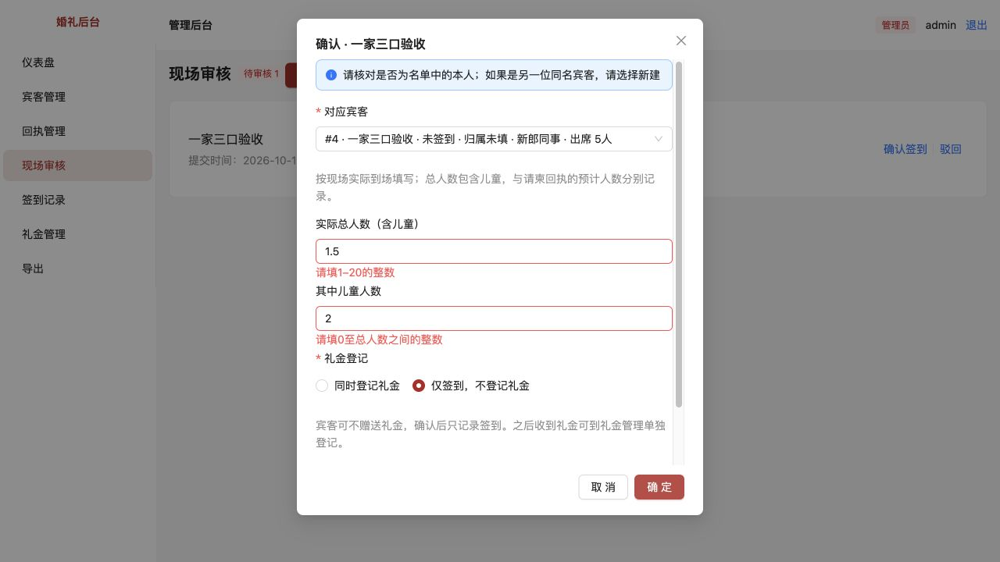
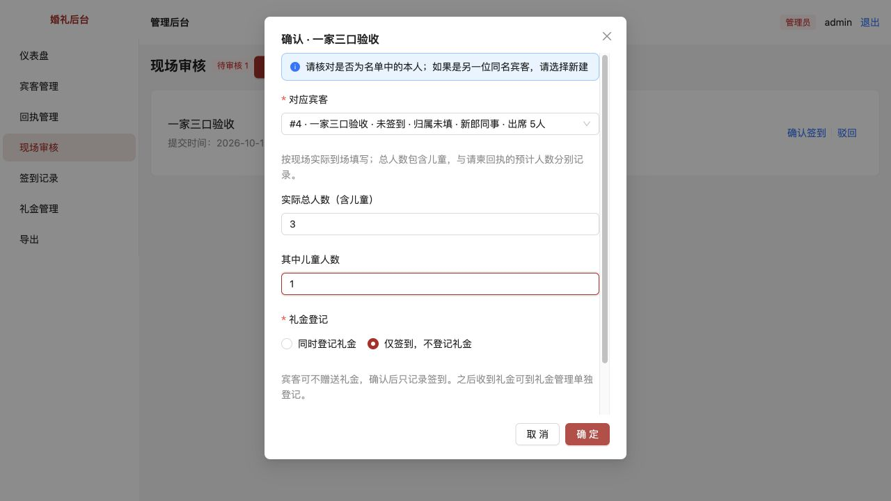
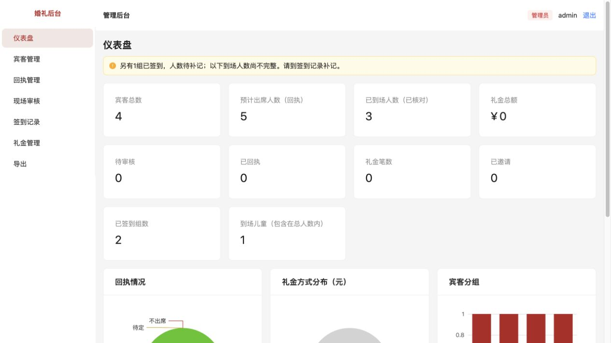
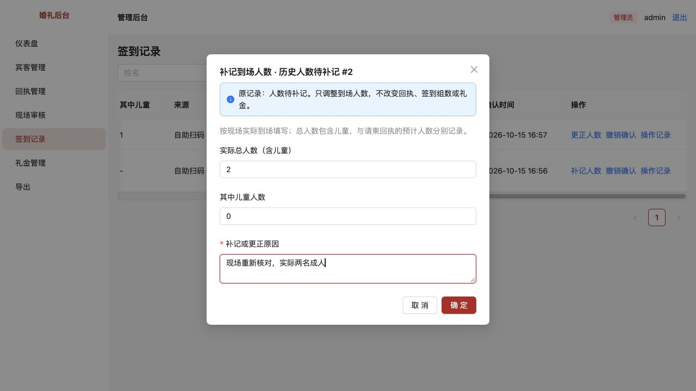
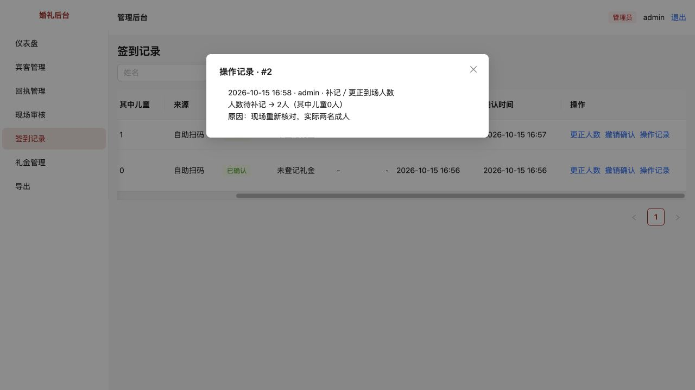
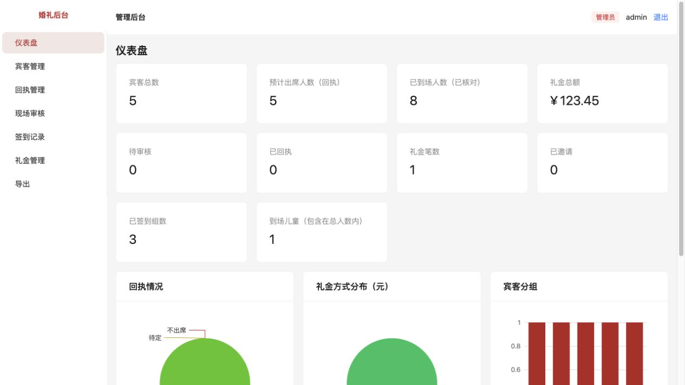
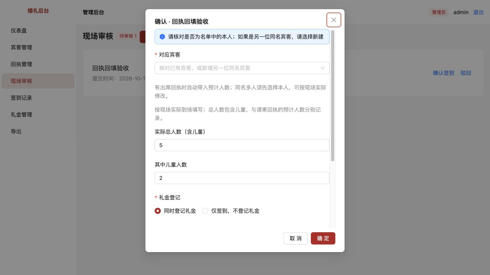
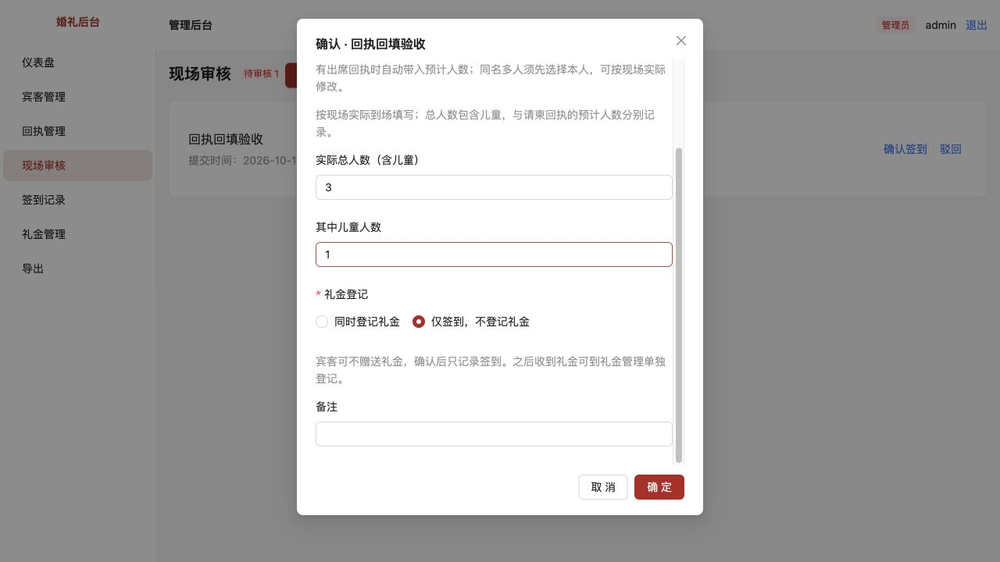
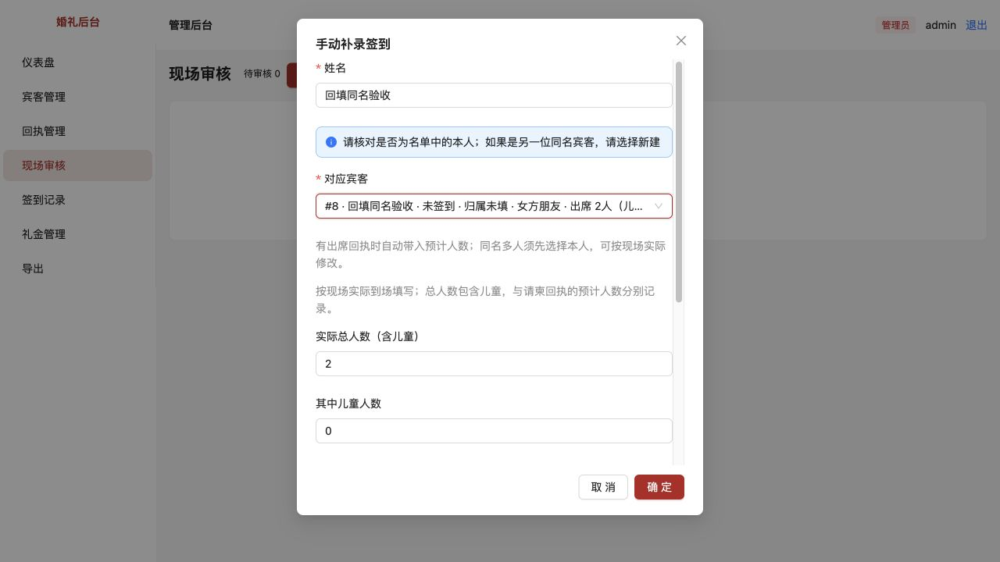

# 实际到场人数与签到组数

> 已归档（2026-10-23）：仅保留当时的方案、进度和验收证据，已停止更新，不作为当前需求或待办。请先查阅[现行文档](../../../../README.md)。

[返回问题索引](../README.md) · [原始审查第9项](../../评审/代码审查与现场审核改进建议.md)

状态：用户验收通过（2026-10-15），含回执人数自动带入和现金默认补充。

## 原问题与复现

原来仪表盘的“实际签到人数”直接使用已确认签到记录条数。让一家三人只登记一次签到，原页面只增加1，而不是3。签到表没有实际人数，不能用回执预计人数来修正，因为预计5人也可能实际只到3人。

## 本次调整

- 扫码仍只需填姓名；工作人员在现场审核、手动补录时核对“实际总人数（含儿童）”及“其中儿童人数”。已有有效出席回执时自动带入回执的总人数和儿童人数，可按现场实际修改；无回执、不出席、待定或异常旧回执时默认1人、0名儿童。唯一匹配宾客可直接带入，同名多人须选定本人后带入。更换宾客时更新初始值，后台刷新不覆盖已经修改的值。总人数必须为1–20的整数，儿童须为0至总人数的整数。
- 实际人数单独保存在签到记录中，不覆盖回执。仪表盘分别展示预计出席人数、已到场人数、已签到组数及到场儿童数；儿童已经包含在到场总人数内。
- 只有“已确认”签到参与到场人数、儿童和组数统计；待审、驳回、撤销均不参与。归档宾客保留已经发生的到场事实；撤销确认减少该组及其人数，恢复时恢复原数，不重复建立签到或礼金。
- 新增迁移 `0004_actual_attendance`，只增加两个可空字段，保留旧签到与所有关联数据。旧签到显示“人数待补记”，仪表盘明确提示有多少组待补记，不猜成1人，也不套用回执人数。
- 管理员在签到记录中可以“补记人数”或“更正人数”，必须填写原因。操作记录显示操作者、时间、修改前后的总人数和儿童人数。修改原记录，不新增签到，不改变礼金或预计出席人数。
- 更正时核对原人数；其他操作者已更改时返回冲突，要求重新核对。人数更新和日志写入在同一事务中，日志失败时一起回滚。
- 签到Excel新增签到编号、实际总人数、其中儿童、当前计入到场人数。已撤销记录保留原人数，但当前计入值为0；未知人数用“待补记”表达。
- 礼金继续保持用户已验收的设置：“同时登记礼金”排第一并默认选中；第二项“仅签到，不登记礼金”仍可选择。现场审核、手动补录及新增礼金的收款方式默认现金，可改为微信或支付宝；编辑已有礼金保留原收款方式。

## 如何验收

停止原开发进程后重新运行 `pnpm dev`，再刷新浏览器。后端启动会自动应用增量迁移，无需重新初始化或清空数据库。

验收以操作前的统计为基准，使用能辨认的测试宾客，避免与真实到场记录混淆。

1. **回执自动带入**：为测试宾客提交出席回执5人、儿童2人。打开该宾客的签到审核，应自动显示5和2；同名多人须选定对应宾客，切换候选后应分别显示各自回执人数。改为3和1并保存，实际到场应使用3和1，回执仍保留5和2。选“新增另一位同名宾客”时回到1和0，不能继承上一位人数。手动补录同样适用。
2. **三人一组**：在现场审核或手动补录里填总人数3、儿童1，选择“仅签到，不登记礼金”后保存。仪表盘应增加3人、1组和1名儿童，礼金不变。回执原来的预计人数不变。
3. **礼金独立**：另一位测试来宾总人数2、儿童0，保留“同时登记礼金”，填123.45并选收款方式。应增加2人、1组、1笔123.45元礼金，不按礼金笔数计算到场人数。
4. **输入防呆**：输入总人数1.5、0、21或总人数1但儿童2，都不能保存。改成3和1才能保存。
5. **人数更正**：管理员打开签到记录，点击测试记录的“更正人数”，将3改为4，填写原因。到场人数只增加1，签到组数、回执与礼金不变。“操作记录”应显示3人到4人、儿童数和原因。
6. **旧记录补记**：若项目已有旧的确认签到，应看到“待补记”和“补记人数”。仪表盘提示人数尚不完整。核对后补记真实人数，提醒中的待补记组数应减少；不能通过默认回执人数自动补齐。
7. **撤销与恢复**：对测试记录执行“撤销确认”，预览明确减少1组及对应人数，保存后统计相应减少，礼金保留。恢复后人数、儿童与组数回到原值，不重复增加礼金。
8. **导出**：导出签到Excel，按“已确认”记录合计“当前计入到场人数”，应与仪表盘一致。已撤销的原人数仍保留、当前计入为0；人数未知的记录应清楚显示待补记。
9. **权限**：工作人员可在审核或补录时登记人数，但只有管理员能补记、更正已确认记录的人数。

## 验证结果

- 当前90项自动测试全部通过，其中人数模型新增8项集成测试，回执回填补充2项测试（同名候选的最新总人数及儿童数、有效与异常回执初始值）。人数模型覆盖：实际与预计分离、无礼金签到、重复及更改内容的重试、非法输入、权限与更正冲突、日志失败回滚、撤销恢复、历史迁移及导出。
- 类型检查、生产构建与差异空白检查通过。
- 首轮独立数据库浏览器实测：回执5人，审核实际3人（含儿童1）；历史一组补记2名成人；第一组更正为4人；手动补录另一组2人并登记123.45元礼金。最终数据库、页面及Excel一致：到场8人、签到3组、儿童1人、预计5人、礼金123.45元。
- 回填补充实测：唯一宾客自动带入5人/儿童2人，现场修改3人/儿童1人保存成功，数据库确认原回执仍为5人/儿童2人。同名选项分别带入4人/儿童1人与2人/儿童0人，选新建另一位回到1人/儿童0人。
- 实测小数人数和儿童超总人数时页面拦截；操作历史能看到待补记到2人的原值变化及原因。
- 旧数据迁移后新增人数为空，原确认时间、礼金原金额与关联保留；重复启动不会重复执行迁移。
- 验收使用独立数据库，没有向业务数据库写入验收签到或礼金。

[下载独立验收环境的签到Excel](签到人数验收导出.xlsx)

## 截图

