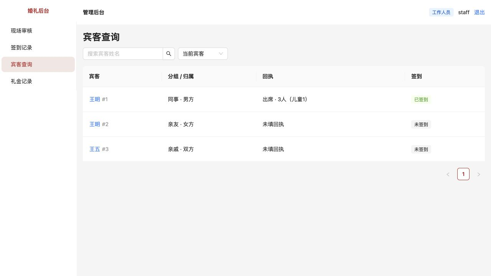
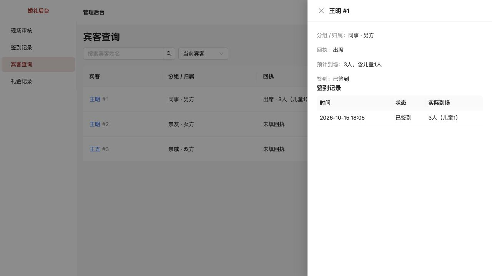
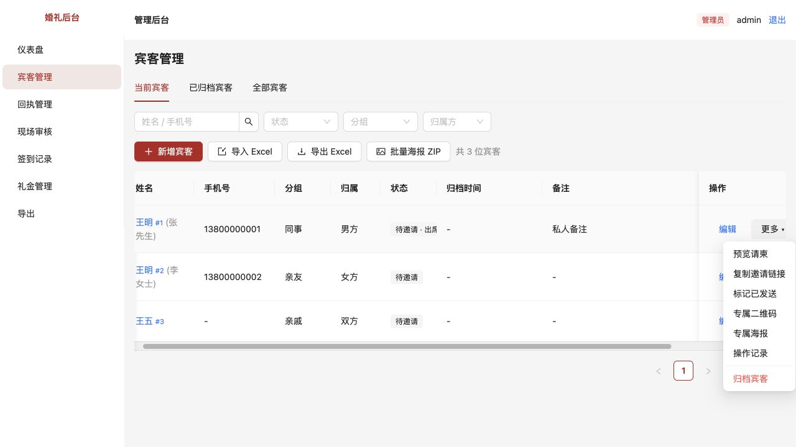

# 工作人员权限与宾客查询简化

> 已归档（2026-10-23）：仅保留当时的方案、进度和验收证据，已停止更新，不作为当前需求或待办。请先查阅[现行文档](../../../../README.md)。

状态：已实现并验证，待用户验收。2026-10-15。

## 原问题如何复现

使用工作人员账号进入宾客管理：页面仍展示手机号、备注、复制邀请链接、二维码和海报；点击姓名详情却返回无权限。此前名单接口也会返回专属邀请凭证，不能仅靠隐藏按钮解决。

管理员名单每行堆积预览、复制、标记发送、二维码、海报、编辑、归档和操作记录，增加现场辨认负担。

## 本次修改

- 工作人员使用独立的“宾客查询”：仅四列，显示姓名及编号、分组及归属、回执人数、签到状态。仅保留姓名搜索与当前/归档/全部范围选择，点击姓名按需看签到详情。
- 列表与详情采用服务端字段白名单，不返回手机号、私人备注、祝福留言、专属邀请凭证或礼金汇总。工作人员按姓名搜索，避免利用手机号搜索探测私人号码。
- 工作人员不能通过直接访问二维码、海报或导出接口绕过页面限制，新增、修改等管理入口仍仅限管理员。
- 管理员每行常驻操作收成“编辑”“更多”；邀请相关操作、操作记录及归档/恢复放进更多菜单。归档仍进入影响核对、原因填写和确认流程。
- 工作人员菜单先显示现场审核；同名宾客始终显示独立编号、分组、归属和签到状态。回执人数取最新回执，未回执不推算人数。

本次未改变工作人员原有现场审核、单笔礼金登记和查看权限。账号停用、改权限后会话即时失效属于后续第15项；本次未实现。其他页面的视觉统一也未全部完成。

## 如何验收

1. 管理员进入“宾客管理”，每行仅显示“编辑”“更多”。展开更多，确认预览、复制链接、发送标记、二维码、海报、操作记录可找到。
2. 点“更多 → 归档宾客”，仍应显示影响范围、原因输入和确认操作。取消后名单和关联数据不变；归档宾客可从对应范围使用“更多 → 恢复宾客”。
3. 退出后用已有工作人员账号登录（默认初始化账号为 staff/staff123，若已更改使用自己的账号）。进入“宾客查询”，只见四列及两个查询控件，无邀请或编辑入口。
4. 搜索一组同名宾客，应显示不同编号、分组、归属和各自签到状态。点其中一人，详情与编号一致，显示回执及实际签到人数，不再提示无权限。
5. 工作人员直接访问 `/api/guests/实际编号/qr` 或 `/api/guests/实际编号/poster` 应返回403；管理员访问有效宾客的同一路径仍可显示图片。
6. 可查看浏览器网络响应：工作人员的宾客列表及详情不包含 inviteToken、inviteUrl、phone、note、message、gifts、giftTotal。

## 实际验证

使用隔离测试数据库，不向业务数据库写入验收数据。105项自动测试全部通过；类型检查、生产构建通过。构建仍有原有图表体积提示，另列第24项。

浏览器实测管理员更多菜单、归档弹窗（取消未提交）、工作人员登录、同名查询与受限详情。管理员二维码及角色越权由接口测试覆盖。

## 后续界面约束

常用操作直接可见，低频操作按需展开；解释文字放在确实需要核对的位置。继续优化时优先减少常驻控件和重复提示。
