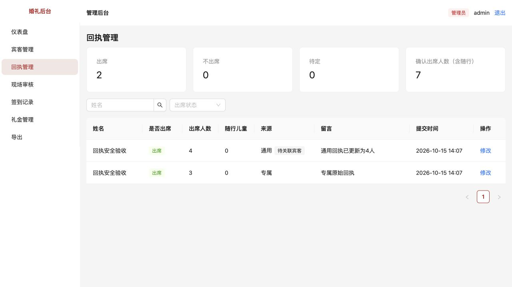

# 逐项整改与验收

对应 [代码审查与现场审核改进建议](./代码审查与现场审核改进建议.md)。每次完成一项，记录原问题、修改内容、复现步骤与验证结果。编号沿用审查报告。

## 第 1 项：同名宾客自动串档

完成日期：2026-10-15。

### 原问题怎么复现

1. 管理员新增两位同名宾客，例如“验收同名”；分别设置“男方 / 朋友”和“女方 / 亲戚”。
2. 在 `/checkin` 自助提交“验收同名”。
3. 打开现场审核并确认，录入测试礼金 600 元。
4. 修复前：系统自动绑定第一位，审核时不能选择第二位，600 元也会记到第一位。
5. 如果第二位同名宾客在第一条还待审时也扫码提交，修复前会被当成第一位重复提交，不会得到独立待审记录。

### 这次改了什么

- 自助签到命中多位同名宾客时，先保存姓名，guestId 留空，不新增第三个宾客档案。
- 两位同名宾客的提交分别进入待审，不能仅凭相同姓名互相去重。
- 待审列表增加“同名待核对”提示；审核弹窗增加必填候选选择。
- 候选显示宾客编号、姓名、归属方、分组、最新回执意向和人数；不返回电话、私有备注、邀请凭证。
- 手动补录输入同名姓名，也必须选择对应宾客；改变姓名会清空之前选择。
- 后端重新检查当前名单；即使绕过表单直接请求，不选同名宾客也返回 409 / AMBIGUOUS_GUEST，不改签到、不记礼金。
- 选择已删除宾客、其他姓名或非法 ID 返回 400，不回退为第一位。
- 旧版本已自动关联、但尚未确认的同名记录，也要求工作人员重新选择；不批量猜测或重写历史账目。
- 无重名时仍直接匹配，未匹配姓名仍自动建档。

### 怎么验收

建议使用独立验收数据库，避免示例宾客和测试礼金混入正式数据。先停止现有开发服务，再在项目根目录执行（Node 24）：

```bash
pnpm exec cross-env DB_PATH=./data/acceptance.db pnpm db:migrate
pnpm exec cross-env DB_PATH=./data/acceptance.db pnpm db:seed
pnpm exec cross-env DB_PATH=./data/acceptance.db pnpm dev
```

上述命令不会修改原来的 wedding.db。验收完成后停止服务，再正常 `pnpm dev` 就会按 .env 恢复使用原数据库；无需把 .env 改为验收数据库。

| 操作 | 应看到的结果 |
| --- | --- |
| admin 登录，新增两位“验收同名”，分别设置男方朋友、女方亲戚 | 两位各有独立编号 |
| 自助提交两次“验收同名” | 待审出现两条，都显示“同名待核对” |
| staff 登录，点第一条“确认并记礼金” | 出现两位候选，归属与分组能区别 |
| 不选宾客直接点确定 | 显示“请选择对应宾客”，不能保存 |
| 选择“女方 / 亲戚”那位，输入600元，确认 | 该提交从待审移除；签到和礼金均属于所选第二位 |
| admin 在宾客详情分别查看两位 | 第二位有本次签到和600元，第一位没有这笔 |
| 点手动补录，输入“验收同名” | 同样出现候选选择，不选不能保存 |
| 手动补录选中一位后改成其他姓名 | 之前的选择被清空，重新核对当前姓名 |
| 新增唯一姓名，或输入一个从未登记的姓名 | 唯一匹配正常；名单外姓名正常自动建档 |

不要在这个验收中再次确认同一位已到场宾客：重复到场与重试幂等属于报告第 3 项，本次不宣称已解决。

### 自动验证

```bash
pnpm test
pnpm typecheck
pnpm build
```

`pnpm test` 在系统临时目录新建数据库，执行结束关闭并清理；测试自身设置 DB_PATH，不会读取当前业务库。

本次新增 10 个回归场景：同名不自动关联、不互相去重、受权候选与字段限制、待审选择提示、未选择不能确认、第二位的签到礼金正确关联、手动补录同名选择、非法/跨姓名选择被拒绝、旧待审记录重新核对、唯一与未匹配行为保留。修改前 9 个失败、1 个通过；修改后 10 个全部通过。

类型检查与生产构建通过。构建仍有原有的大图表分块提示，对应报告第 24 项。

浏览器实测：独立临时数据库 + 独立端口；staff 看见同名标记和两位候选，不选择被阻止；选择女方亲戚并录600元成功，数据库确认 checkin.guest_id 和 gift.guest_id 都是第二位、金额为60000分。另检查手动补录同名时会出现必选项。未修改原业务数据库。


### 追加优化：对应宾客选项显示签到状态（2026-10-15）

审核确认、手动补录的候选文字增加“已签到／未签到”，按宾客ID分别查询；只有已确认的签到算“已签到”，待审核提交不算。确认后刷新候选缓存，重新选择时更新状态。

验收：准备两位同名宾客，先确认第一位签到，再打开同名提交的审核弹窗，第一位应显示“已签到”、第二位“未签到”；第二位只有待审核提交时仍应显示“未签到”。手动补录输入同名也应看到相同状态。本次新增该状态口径回归测试，全部15项测试与类型检查通过，无数据库迁移。

## 优先修复：登录需要输入两次账号密码

完成日期：2026-10-15。用户反馈后优先插入处理，属于原报告第 19 项中登录/退出缓存管理的修复；跨页面数据更新仍按原计划继续。

### 原问题怎么复现

1. 登录管理员，进入首页。
2. 点击右上角“退出”，停留在登录页，不刷新页面。
3. 输入正确账号密码，点击一次登录。
4. 修复前会回到空白登录表单，再输入一次相同账号密码才进入首页。本次在实际浏览器中复现。

原因：退出时后台仍在挂载，刷新身份查询会缓存401错误；登录成功后只 invalidateQueries，没有把登录返回的用户写入缓存。跳转回后台时 RequireAuth 可能先读到旧的错误状态再次送回登录，稍后的身份请求成功后，第二次登录才正常。首次加载较慢时不一定触发，因此不能只测试冷启动。

### 修改与验收

- 登录成功后，先取消旧请求并清除旧账号缓存，立即以服务端返回的用户建立成功的身份状态，再跳转。
- 退出成功后，取消请求并清空身份、礼金汇总、宾客详情等缓存，不再在仍挂载的后台触发全量刷新。
- 未修改密码、账号、Cookie策略或数据库，不需要迁移；前端刷新即可加载修复。

| 验收操作 | 预期结果 | 本次浏览器结果 |
| --- | --- | --- |
| 管理员登录→退出→正确密码登录一次 | 直接进入仪表盘，表单不被清空后再次显示 | 通过 |
| 登录成功后刷新首页 | 仍保持登录 | 通过 |
| 先输错密码，再改正确密码登录一次 | 错误密码被拒绝；纠正后直接进入仪表盘 | 通过 |
| 管理员退出，改用staff登录一次 | 直接进入现场审核，显示工作人员身份 | 通过 |

自动测试新增4项：带旧数据的401身份缓存可被首次登录正确替换；迟到身份请求不能覆盖新身份；切换账号移除旧账号业务数据；退出后迟到请求不能重新写回旧缓存。执行 `pnpm test`，连同前一项共14个测试全部通过；`pnpm typecheck`、`pnpm build`通过。


## 第 2 项：通用链接不能仅凭姓名覆盖专属回执

完成日期：2026-10-15。也解决报告第 8 项中“同浏览器更新通用回执重复新增”的问题。

### 原问题怎么复现

1. 管理员新增一位“回执安全验收”，复制其专属链接。
2. 打开专属链接，提交“出席3人”，留言“专属原始回执”。
3. 打开通用链接 `/invite`，输入相同姓名，提交“出席2人”。
4. 修复前：系统按姓名找到这位宾客并覆盖专属回执，原3人变为2人，无需持有专属链接。通用入口中没匹配到名单的姓名，反复点击“更新回执”还会生成多条记录。

### 这次改了什么

- 通用回执不再按姓名关联或覆盖名单；第一次提交建立独立回执，后台标记“通用 · 待关联宾客”。
- 浏览器打开通用请柬时，服务端准备随机私有修改凭证，以 HttpOnly、SameSite=Lax Cookie 保存；数据库只保存 SHA-256 摘要，凭证不出现在网页链接、回执JSON或导出中。
- 同一浏览器持有凭证，修改和重新打开都能找到自己的原回执；两个浏览器即使同名也不互相覆盖。
- 提交前先确认凭证已准备；丢失/损坏凭证不按姓名找回。清除浏览器记录、换浏览器、换设备或180天后Cookie过期，需要联系新人协助。一个浏览器保存一份通用回执，适合本人或一家庭；不把改姓名视为替另一位亲友新增。
- 同凭证的重复请求在事务内更新同一条记录，数据库摘要唯一索引保护首次创建；网络重试不会多记一组。
- 通用回执校验姓名、意向、整数人数、儿童与总人数关系、留言长度；不出席和待定人数归零，不计入已确认出席人数。客户端计数器同步限制，避免正常操作产生无效值。
- 恢复回执失败会显示重试入口，不能在凭证未准备好时直接提交；切换请柬时清空上一份预填内容。

### 你可以只看页面这样验收

本地验收入口已补齐：开发配置默认 `PUBLIC_BASE_URL=http://localhost:5173`，管理员在“宾客管理”每一行点击“预览请柬”可直接打开当前网站的专属页面，不依赖公网域名。也可重新点击“复制链接”，应得到 localhost 地址。原来复制的 example 地址需重新复制；婚礼姓名、图片仍是演示素材，不影响回执功能验收。以后正式部署时，把 PUBLIC_BASE_URL 改为自己的 HTTPS 域名。

建议仍使用上文独立验收数据库。重启 `pnpm dev` 时后端会自动执行新增迁移；也可先执行 `pnpm db:migrate`。**无需再执行 db:generate，也无需安装数据库图形工具。**

| 操作 | 应看到的结果 |
| --- | --- |
| 管理员新增测试姓名，通过专属链接填3人、留言“专属原始回执” | 后台出现一条来源“专属”的3人回执 |
| 通用 `/invite` 填同名、2人、留言“通用首次” | 后台增加另一条“通用 · 待关联宾客”；原专属仍是3人 |
| 同一通用页面改为4人、改留言，点击“更新回执” | 通用那条更新为4人，记录仍共两条 |
| 刷新通用页并打开请柬 | 姓名、4人、留言自动预填，按钮为“更新回执” |
| 重新打开原专属链接 | 仍预填原来的3人和“专属原始回执” |
| 用另一浏览器/独立隐私窗口打开通用页 | 不显示前一浏览器的回执，填写相同姓名也只新建独立通用回执 |
| 把自己的通用回执改为不出席 | 通用那条人数归0，专属回执不变 |

注意：同一浏览器的普通新标签页共享凭证，不能把“新开一个普通标签页”当成另一位宾客。需要用另一浏览器或独立隐私会话验证隔离。

当前“待关联宾客”是明确的数据标记，尚未提供人工关联/合并入口；本次不会自动合并同名记录，也不会去重历史回执。回执统计会将这些独立记录分别计算，管理员仍需核对是否为不同邀请组。新增凭证不能恢复此前已经被覆盖的历史内容；历史通用回执没有凭证，不能安全地仅凭姓名交还给浏览器修改。

### 自动验证与兼容性

新增12个回归场景，覆盖无凭证不能覆盖专属、伪造ID/token不能指定他人、同浏览器更新与恢复、两浏览器同名隔离、凭证丢失/损坏、并发重试只建一条、摘要与Cookie属性、历史记录不被接管、无效输入不写入、专属入口保持可用、旧数据库迁移保留数据。

修改前12项中11项失败；修改后全部通过。执行 `pnpm test` 共27项通过，类型检查和生产构建通过。迁移只新增可空字段及唯一索引，历史数据和关联保持原样，不写入或重置账号。

浏览器实测使用独立临时数据库和独立端口：同名专属3人，通用首次2人后改4人，刷新恢复4人；后台仍只有两条记录并显示不同来源。测试数据没有写入正常业务库。



## 后续顺序

下一项：报告第 3 项“已确认后重新扫码会重复签到”。之后处理第 4–7 项的事务、并发、删除权限与请求校验，再推进现场工作台和整体平面化界面。每项都沿用上述记录格式。
