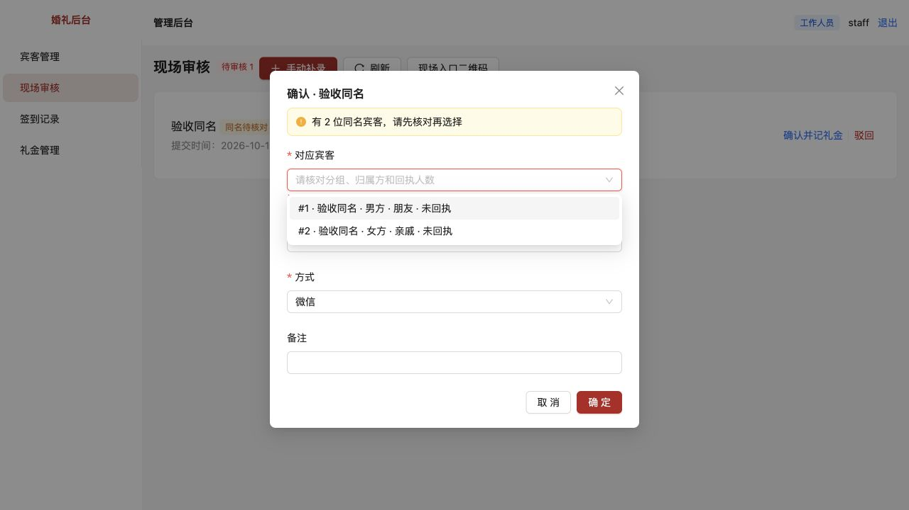

# 第 1 项：同名宾客自动串档

[文档索引](../../README.md) · [问题目录](../README.md) · [原始审查报告](../../评审/代码审查与现场审核改进建议.md)

完成日期：2026-10-15。

后续补充：[现场临时宾客重名无法登记](../现场临时宾客重名无法登记/README.md)允许工作人员在候选列表中直接新建另一位同名宾客。

## 原问题怎么复现

1. 管理员新增两位同名宾客，例如“验收同名”；分别设置“男方 / 朋友”和“女方 / 亲戚”。
2. 在 `/checkin` 自助提交“验收同名”。
3. 打开现场审核并确认，录入测试礼金 600 元。
4. 修复前：系统自动绑定第一位，审核时不能选择第二位，600 元也会记到第一位。
5. 如果第二位同名宾客在第一条还待审时也扫码提交，修复前会被当成第一位重复提交，不会得到独立待审记录。

## 这次改了什么

- 自助签到命中多位同名宾客时，先保存姓名，guestId 留空，不新增第三个宾客档案。
- 两位同名宾客的提交分别进入待审，不能仅凭相同姓名互相去重。
- 待审列表增加“同名待核对”提示；审核弹窗增加必填候选选择。
- 候选显示宾客编号、姓名、归属方、分组、最新回执意向和人数；不返回电话、私有备注、邀请凭证。
- 手动补录输入同名姓名，也必须选择对应宾客；改变姓名会清空之前选择。
- 后端重新检查当前名单；即使绕过表单直接请求，不选同名宾客也返回 409 / AMBIGUOUS_GUEST，不改签到、不记礼金。
- 选择已删除宾客、其他姓名或非法 ID 返回 400，不回退为第一位。
- 旧版本已自动关联、但尚未确认的同名记录，也要求工作人员重新选择；不批量猜测或重写历史账目。
- 无重名时仍直接匹配，未匹配姓名仍自动建档。

## 怎么验收

先按[本地开发与验收](../../技术/本地开发与验收.md)准备独立验收环境。

| 操作 | 应看到的结果 |
| --- | --- |
| admin 登录，新增两位“验收同名”，分别设置男方朋友、女方亲戚 | 两位各有独立编号 |
| 自助提交“验收同名”，点击“为另一位宾客登记”后再次提交同名 | 待审出现两条，都显示“同名待核对” |
| staff 登录，点第一条“确认并记礼金” | 出现两位候选，归属与分组能区别 |
| 不选宾客直接点确定 | 显示“请选择对应宾客”，不能保存 |
| 选择“女方 / 亲戚”那位，输入600元，确认 | 该提交从待审移除；签到和礼金均属于所选第二位 |
| admin 在宾客详情分别查看两位 | 第二位有本次签到和600元，第一位没有这笔 |
| 点手动补录，输入“验收同名” | 同样出现候选选择，不选不能保存 |
| 手动补录选中一位后改成其他姓名 | 之前的选择被清空，重新核对当前姓名 |
| 新增唯一姓名，或输入一个从未登记的姓名 | 唯一匹配正常；名单外姓名正常自动建档 |

重复到场与重试保护已在[第3项：重复签到与重复记账](../03-重复签到与重复记账/README.md)补齐，可按该项步骤验收。

## 自动验证

```bash
pnpm test
pnpm typecheck
pnpm build
```

`pnpm test` 在系统临时目录新建数据库，执行结束关闭并清理；测试自身设置 DB_PATH，不会读取当前业务库。

本项修复当时新增 10 个回归场景：同名不自动关联、不互相去重、受权候选与字段限制、待审选择提示、未选择不能确认、第二位的签到礼金正确关联、手动补录同名选择、非法/跨姓名选择被拒绝、旧待审记录重新核对、唯一与未匹配行为保留。修改前 9 个失败、1 个通过；修改后 10 个全部通过。

类型检查与生产构建通过。构建仍有原有的大图表分块提示，对应报告第 24 项。

浏览器实测：独立临时数据库 + 独立端口；staff 看见同名标记和两位候选，不选择被阻止；选择女方亲戚并录600元成功，数据库确认 checkin.guest_id 和 gift.guest_id 都是第二位、金额为60000分。另检查手动补录同名时会出现必选项。未修改原业务数据库。



## 追加优化：对应宾客选项显示签到状态（2026-10-15）

审核确认、手动补录的候选文字增加“已签到／未签到”，按宾客ID分别查询；只有已确认的签到算“已签到”，待审核提交不算。确认后刷新候选缓存，重新选择时更新状态。

验收：准备两位同名宾客，先确认第一位签到，再打开同名提交的审核弹窗，第一位应显示“已签到”、第二位“未签到”；第二位只有待审核提交时仍应显示“未签到”。手动补录输入同名也应看到相同状态。本次新增该状态口径回归测试，全部15项测试与类型检查通过，无数据库迁移。
