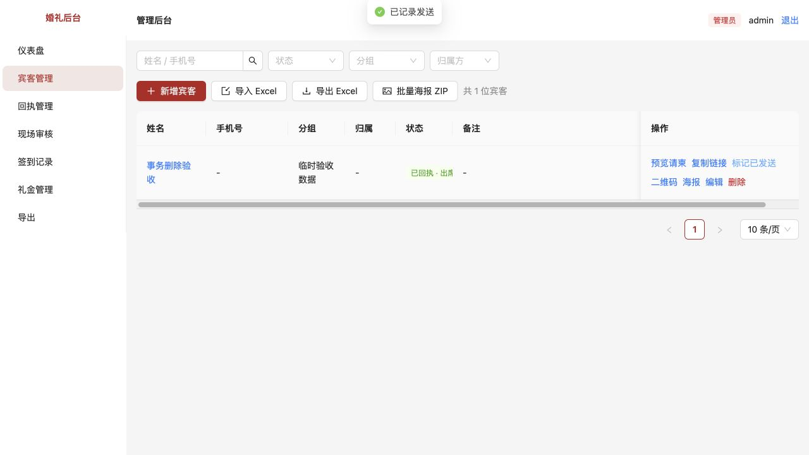
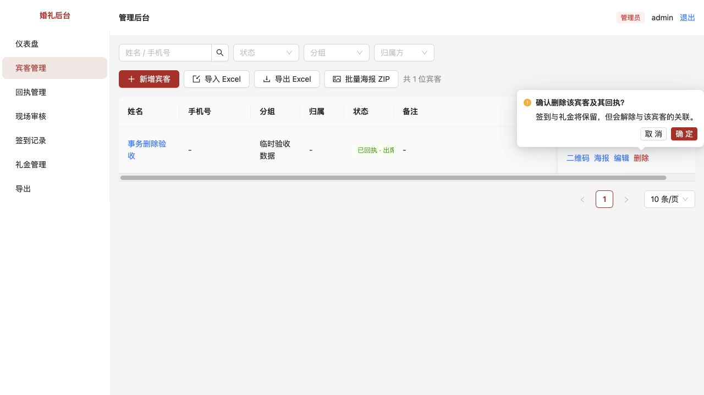
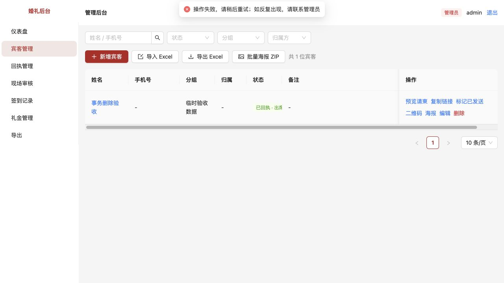
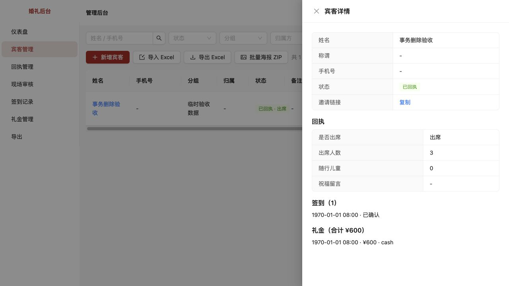
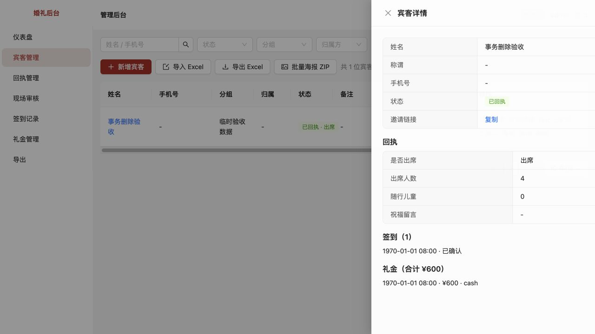

# 第4项：宾客删除与回执保存不完整

> 历史记录：本页保留第4项当时的事务修复与验收证据。删除宾客及解除关联的规则已由[第6项统一数据操作](../06-删除改为可追溯业务操作/README.md)替代，当前使用归档、恢复与完整关联保留。

[文档索引](../../README.md) · [问题目录](../README.md) · [验收环境](../../技术/本地开发与验收.md) · [原始审查报告](../../评审/代码审查与现场审核改进建议.md)

完成日期：2026-10-15。已修复并验证，待用户验收。继续第4项的宾客删除、回执与状态同步；签到确认与礼金事务已在第3项完成。本项也补齐批量导入事务，并解决第10项中“标记发送导致状态倒退”的现有流程问题。

## 原问题怎么复现

### 删除只完成一半

宾客有回执、签到和礼金时，删除操作依次删除回执、解除签到关联、解除礼金关联、删除宾客。修复前，模拟第三步写入失败后，接口虽然报错，回执却已经消失、签到关联也已清空，宾客和礼金仍存在。

### 回执与状态对不上

首次提交专属回执时，原实现先把宾客改为“已回执”，再创建回执。模拟创建失败后，宾客仍显示已回执，实际没有回执。已有回执更新人数后，如果同步宾客状态失败，更新的人数也不会回滚。

慢请求还有时间窗口：请求读取到宾客或回执后等待请求体，此时另一操作删除了宾客；旧请求继续写入，可能留下孤立回执或返回500。

### 页面直接可复现的状态倒退

修复前，提交专属回执后，在宾客管理点击“标记已发送”，会把“已回执”改成“已发送”，仪表盘已回执数量随之减少。已经查看请柬的宾客也会退回已发送。

批量导入也有同类问题：第二位宾客写入失败时，第一位已经保存，整次导入却报错，直接重试可能再次导入前半批。

## 修改内容

- 删除宾客时，把读取宾客、删除回执、解除签到和礼金关联、删除宾客放在同一个写事务中，任何一步失败全部回滚。成功删除仍保留签到姓名、礼金金额及签到与礼金之间的关联。
- 专属回执和宾客“已回执”状态一起提交。异步请求体先读取完成，再在事务里重新查询当前宾客；已经删除的请柬返回404，不写孤立记录。
- 管理员修改回执时也在事务内重新核对记录，并同步关联宾客的已回执状态；未关联的通用回执仍保持独立，不按姓名关联。
- Excel解析在事务外完成，通过解析的有效行整批写入；数据库写入失败时整批回滚。原有“跳过格式错误行并报告行号”的规则保留。
- 标记发送只把待邀请推进为已发送，保留已查看和已回执；有真实关联回执的旧降级记录在本次操作时恢复为已回执。重复标记保留首次发送时间。
- 修改后刷新宾客、详情、回执、候选、礼金、签到与统计相关缓存，防止页面继续显示旧数据。
- 删除确认说明明确告知“回执删除，签到和礼金保留但解除关联”；失败显示错误提示，服务端异常统一返回错误信息，不再误提示后端没有启动。
- 无需数据库迁移，不批量修改历史数据。

## 只看页面怎么验收

重启开发服务并刷新页面，建议按[本地开发与验收](../../技术/本地开发与验收.md)使用独立验收库。

| 操作 | 应看到的结果 |
| --- | --- |
| 新增测试宾客，通过其专属请柬提交出席3人 | 宾客显示“已回执 · 出席”，回执为3人 |
| 对该宾客点击“标记已发送”，重复点击一次 | 仍为已回执，仪表盘已回执数量不减少 |
| 后台回执管理把3人修改为4人，返回宾客管理打开详情，再查看仪表盘 | 回执与详情均为4人，确认出席人数相应更新，无需手动刷新整页 |
| 另建测试宾客，只打开专属请柬、不提交，再标记已发送 | 保留“已查看”，不退回已发送 |
| 为测试宾客补录签到和600元测试礼金，再点击宾客删除 | 确认框说明会删除回执，签到和礼金保留但解除关联 |
| 确认删除这个测试宾客 | 名单与对应回执移除；签到和600元礼金仍保留，礼金总额不因删除宾客减少 |

最后两步会删除测试宾客与测试回执，请使用为验收专门新建的记录。异常回滚无需手动制造数据库故障，可用下节自动测试验证。

## 异常复现与自动验证

在Node 24环境、项目根目录运行：

```bash
pnpm test
pnpm typecheck
pnpm build
```

新增测试文件 `tests/write-consistency.test.ts` 使用独立临时数据库，模拟写入故障的触发器只装在临时库中，测试结束清理，不连接业务数据库。

新增10项：删除中途失败回滚、删除最后一步失败回滚、回执首次写入失败回滚、回执更新后状态写入失败回滚、专属慢请求遇宾客删除、后台慢请求遇回执删除、后台回执与宾客状态同步回滚、标记发送不降级与首次发送时间、导入中途失败整批回滚、格式错误行兼容与通用回执隔离。

修改前新增10项中9项失败、1项通过；修改后全项目54项通过。类型检查和生产构建通过，保留原有大图表分块提示。

浏览器在独立验收库和独立端口验证：

- 已回执宾客标记发送后仍显示已回执。
- 临时库模拟解除礼金关联失败，页面提示操作失败，宾客仍存在；详情与数据库核对3人回执、1条已确认签到、600元礼金及各自关联均保留。
- 解除临时故障后，后台把回执改为4人，返回之前已打开过的宾客详情，正确显示4人。

## 验收截图











## 后续边界

本项解决保存完整性。已确认签到的删除权限、礼金作废与审计流程继续按第6项处理；专属和后台回执的其余输入校验按第7项处理。不自动修补此前已损坏或重复的历史记录，也不替管理员判断两次不同操作是否应合并。
