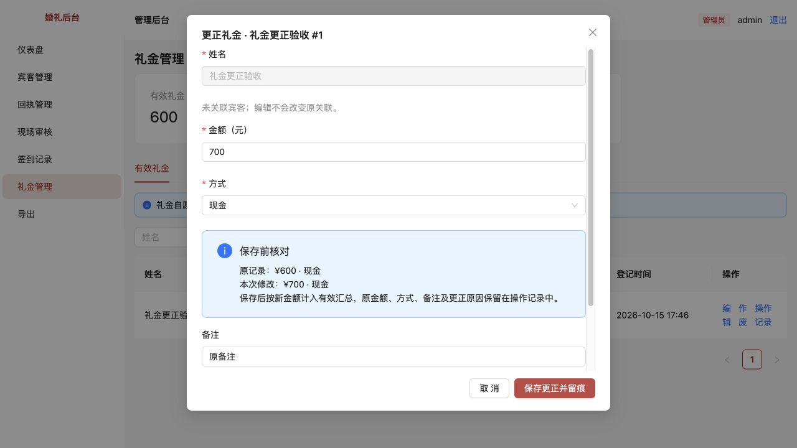
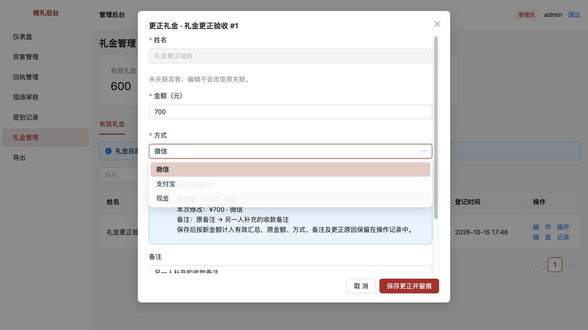
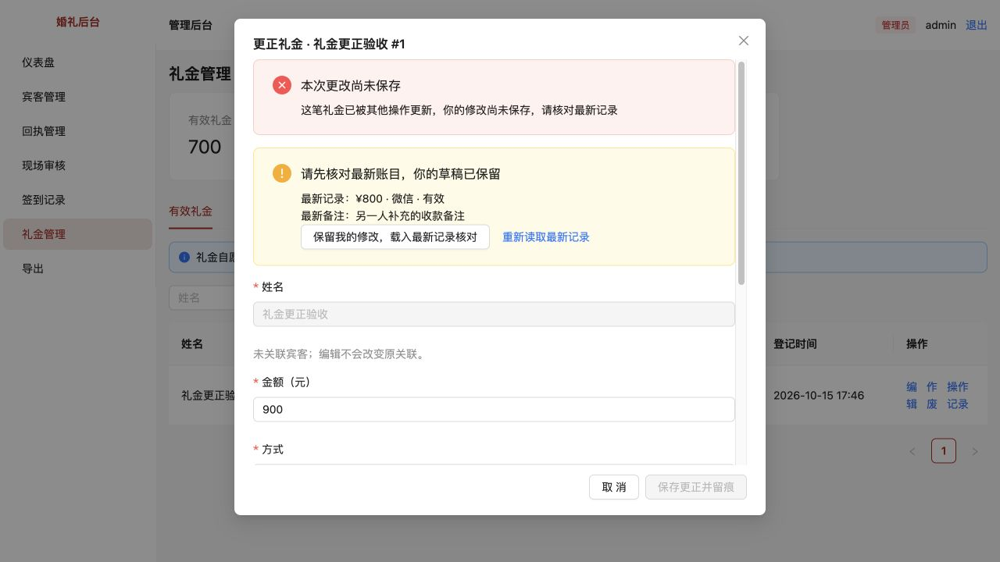
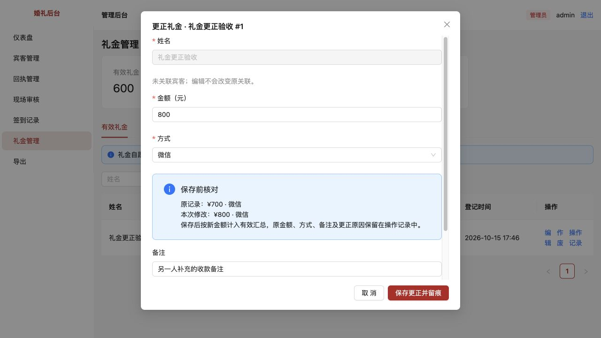
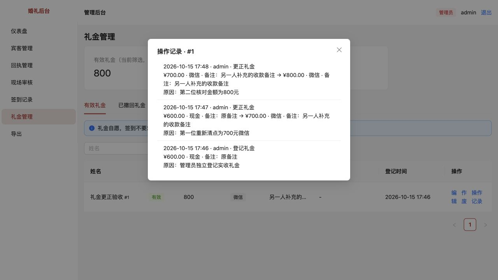
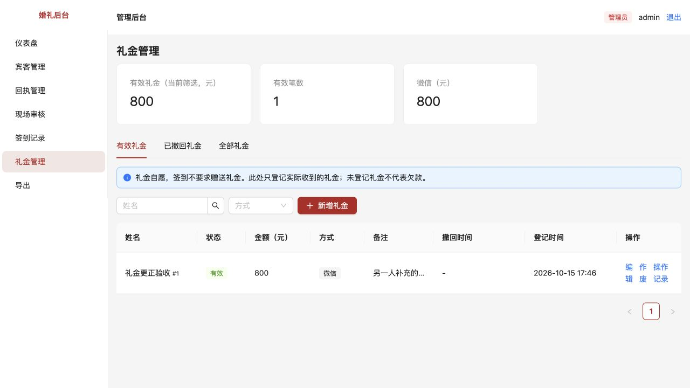

# 礼金更正留痕与并发保护

[返回问题索引](../README.md) · [总体优化进度](../../评审/优化进度与剩余清单.md)

状态：用户验收通过（2026-10-15）。本次补齐原审查第12项中的登记、更正留痕与版本保护。

## 原问题与复现

原来修改礼金只更新金额、方式或备注，没有记录谁在何时因为什么修改，也没有保存原值。两个浏览器同时打开同一笔600元礼金，第一份改700保存，第二份再按旧内容保存800，两次均成功，第一份修改会被覆盖。还可能连带把第一份新补充的备注或收款方式改回旧值。

## 本次调整

- 管理员更正礼金时必须填写原因（1–200字），页面展示原金额、方式及本次修改预览。按钮明确为“保存更正并留痕”。没有实际改动不增加版本或日志。
- 礼金独立登记、现场审核记礼金和手动补录记礼金都记录实际登录操作者、登记时间及初始内容。仅签到不生成礼金或礼金日志；同次补录重试不重复记录。
- 更正时保存金额、方式、备注修改前后的完整记录、操作者、时间及原因。姓名、宾客、签到关联和首次登记时间保持原值，不能借编辑接口改绑。
- 礼金新增时从版本1开始；每次更正、作废和恢复均增加版本。旧编辑窗口必须携带打开时的版本，事务内检查后才可保存。金额改回原值、作废再恢复都不能让旧窗口重新有效。
- 冲突时保留当前草稿，显示服务端最新金额、方式及备注，并暂停保存。选择“保留我的修改，载入最新记录核对”后，保留自己实际修改过的字段，其余字段采用最新记录，再展示预览，必须重新点击保存。
- 例：A保存700元/微信/新备注，B原本只把600改800。B先被拦截，重新核对后为800元/微信/新备注；不会把A的方式和备注改回去。若双方修改同一个字段，仍需要操作者对照最新值判断要保存哪一个。
- 礼金内容、版本及操作日志在同一事务中保存。日志写入失败时整笔回滚；现场登记礼金日志失败也会回滚对应签到、关联和幂等结果，避免半成功。
- 所有礼金新增和更正日志均可在“操作记录”中查看。工作人员仍不能修改礼金，也不能调用管理员的最新记录或礼金历史接口。

## 升级与数据保留

后端启动自动执行 `0005_gift_edit_version`，仅新增版本字段，旧礼金初始化为1。不会伪造旧礼金的历史操作者；升级前没有记录的修改无法凭空恢复，升级后的首次更正会保存当时的原记录。

本项继续沿用“实际收到才登记礼金”的现有流程，未引入待核对、到账确认、收款人和红包编号等新流程；这些仍属于第12项剩余设计。礼金Excel继续导出当前登记值，完整修改历史在操作记录中查看。

## 如何验收

重启 `pnpm dev` 并刷新两个浏览器窗口，确保界面和后端均已升级。下面请使用测试礼金，避免改动真实账目。

1. **必填与预览**：新增一笔测试礼金600元现金，备注“原备注”。点编辑改700，不填更正原因，应不能保存。填写具体原因，核对原值和新值后保存。
2. **操作记录**：应能看到登记600元及更正600→700元；包含操作者、时间、原因和方式、备注前后内容。有效合计只按700元计算，礼金仍是同一笔。
3. **两个窗口冲突**：两个窗口先同时打开同一笔600元礼金。A改700、微信、备注“另一人补充”，填原因保存。B只改金额800后保存，应提示其他操作已更新；B的800元与原因仍保留，最新记录显示700元/微信/新备注，保存按钮禁用。
4. **重新核对**：在B点“保留我的修改，载入最新记录核对”，应保留金额800，同时采用最新微信和新备注。页面原记录变为700元/微信，本次修改800元/微信。核对后再保存，最终800元且新备注保留。
5. **持续冲突保护**：B重新核对但尚未保存时，如果A又改了记录，B保存仍应被再次拦截，不能绕过检查。
6. **作废恢复保护**：一个窗口打开编辑，另一个窗口作废并恢复同一笔礼金，旧窗口再保存应被拦截；作废状态本身不允许编辑。
7. **现场登记留痕**：由工作人员在现场审核或手动补录登记测试礼金，管理员查看礼金操作记录，应看到该工作人员的登记身份和来源。仅签到时不产生零元礼金或礼金日志。
8. **原值保留**：只改金额时原方式、备注和宾客签到关联不应改变；更正不增加签到组数或礼金笔数，只更新对应金额与方式分布。

## 验证结果

- 101项自动测试全部通过，本项新增10项集成测试：新增和编辑审计、部分字段更新、原因与版本校验、权限、并发及延迟请求体、金额改回原值、作废恢复、日志失败回滚、签到登记审计与重试、旧数据迁移。
- 类型检查、生产构建和差异空白检查通过。
- 双窗口浏览器实测：600元现金→A更正700元微信并补备注→B旧草稿800元被拦截→重新核对后保存800元微信，原新备注保留。再次用另一个旧窗口尝试900元仍被拦截，没有生成额外更正日志。
- 浏览器确认更正原因缺失时拦截；操作历史清楚列出600→700→800的完整轨迹与原因。
- 独立验收数据库终态：1笔80000分微信礼金，版本3，原首次登记时间保持，备注完整；3条礼金日志，依次为新增及两次更正。
- 审计故障测试确认金额、版本及新增签到关联整体回滚；旧礼金迁移后原金额、方式、关联与时间保留，没有补造历史日志。
- 浏览器及故障测试均使用独立数据库，未将验收数据写入业务数据库。

## 截图

