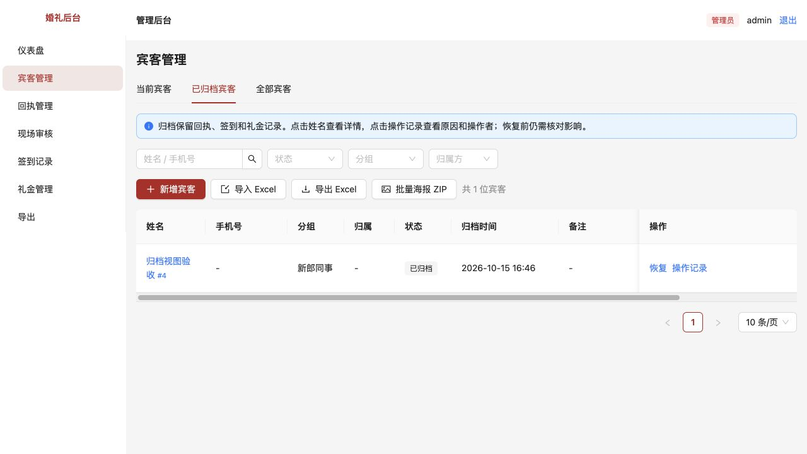
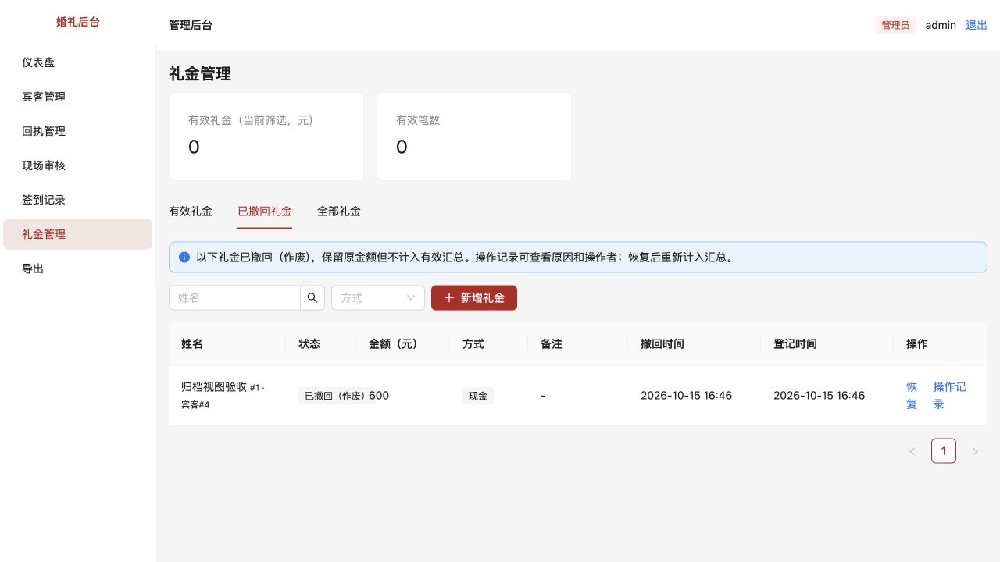
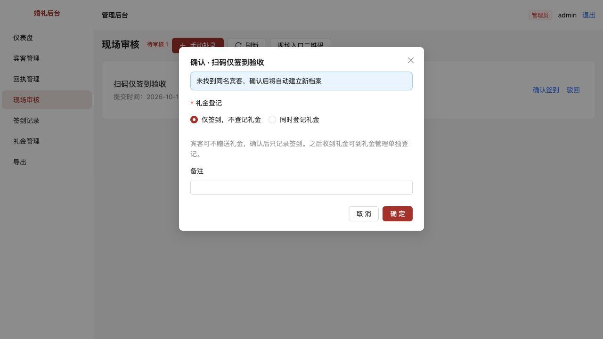
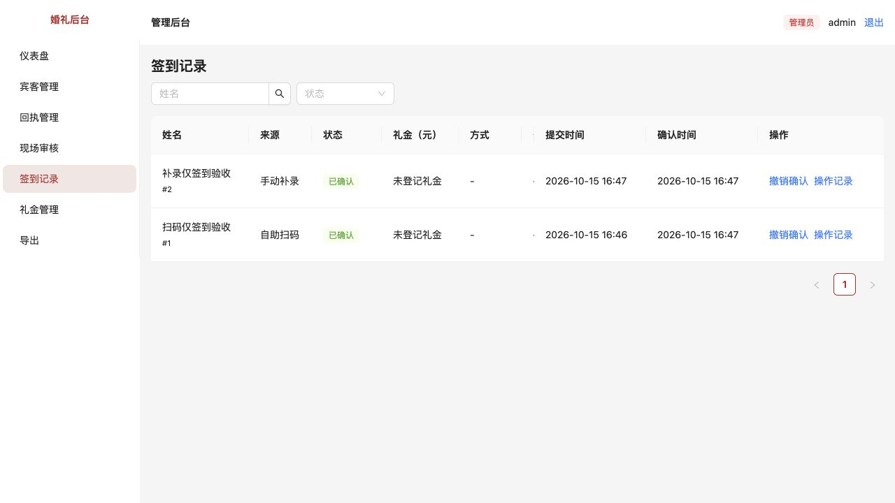

# 历史记录视图与自愿礼金

[返回问题索引](../README.md)

状态：用户验收通过（2026-10-15），包含登记礼金优先及默认选中的补充。本次不新增数据库迁移。

## 原问题与复现

- 在宾客管理归档一位宾客，记录离开默认名单。原入口在“当前宾客”下拉框里，必须展开才能发现“已归档宾客”。礼金作废记录也隐藏在类似筛选里，容易误认为记录消失。
- 现场审核按钮叫“确认并记礼金”，没有礼金也要填0，且仍显示支付方式，容易使操作者误认为签到必须收礼金。

## 调整

- 宾客管理顶部直接展示“当前宾客／已归档宾客／全部宾客”三个标签。历史视图显示归档时间，可以点击姓名查看原关联详情、查看操作记录、核对后恢复。
- 礼金管理直接展示“有效礼金／已撤回礼金／全部礼金”。撤回对应原来的作废状态，保留原金额、撤回时间和操作记录，不计入有效汇总。恢复仍沿用影响预览和填写原因的流程。
- 切换视图时清空姓名、状态、分组、方式等筛选并回到第一页，避免旧条件隐藏历史记录。空列表明确说明没有对应记录。
- 现场按钮改为“确认签到”。扫码审核和手动补录均将“同时登记礼金”排在第一项并默认选中；第二项“仅签到，不登记礼金”仍可选择，选中后不显示金额与收款方式。
- 选“同时登记礼金”才要求实际金额与收款方式；从此选项切回仅签到时清除金额字段，并强制提交0，后端只登记签到、不创建零元礼金。
- 已确认但没有关联礼金的签到显示“未登记礼金”。该描述不等于认定来宾没送礼：也可能稍后单独记账。系统不将其当成欠款。

## 验收方法

重启 `pnpm dev` 后刷新页面。请用可辨认的验收记录操作，归档与撤回均可通过管理员恢复。

1. **归档视图**：归档一位测试宾客；点击顶部“已归档宾客”，应看到该记录及归档时间。点姓名能打开详情，点“操作记录”能看到原因及操作者。“当前宾客”中不应出现该记录，“全部宾客”中应出现。恢复需核对影响、填写原因，恢复后返回当前名单。
2. **撤回视图**：将一笔测试礼金作废；点击“已撤回礼金”，应看到原金额、撤回时间、“恢复”和“操作记录”。该笔不计入有效金额或笔数；“全部礼金”中保留该笔。恢复后有效金额只增加原记录金额一次。
3. **筛选重置**：在当前名单搜索一个不匹配的姓名，再切到归档视图，搜索条件应清空，已归档记录不被旧条件隐藏。
4. **无礼金扫码确认**：在现场审核点“确认签到”，默认选中第一项“同时登记礼金”；切换到“仅签到，不登记礼金”后，不填写金额和方式也可成功确认。签到记录显示“已确认／未登记礼金”，有效礼金总额与笔数不变。
5. **无礼金补录**：手动补录一位测试来宾，默认选中第一项“同时登记礼金”；切换到“仅签到，不登记礼金”，填姓名并核对宾客后确认，同样不产生礼金。
6. **切换防误记**：选择“同时登记礼金”，填600，再切回“仅签到”后确认，不能产生600元或0元礼金。
7. **自愿登记礼金**：另一位测试来宾选择“同时登记礼金”，填123.45并选择现金，应产生一条12345分的有效礼金；缺少金额或方式不得保存。后续追加礼金可以由管理员在礼金管理单独登记，不需重复签到。

## 实际验证

- 80项自动测试通过，包括新增历史视图筛选、原金额保留、无礼金两种签到、后续单独登记礼金不重复签到的回归测试。
- 类型检查、前端构建、差异空白检查通过。
- 在独立验收数据库实测：归档宾客及操作原因可见；撤回礼金600元可见但有效合计0；两条无礼金签到均确认成功且没有关联礼金；另一条自愿礼金签到成功登记12345分。
- 已实测填写600后切回仅签到，数据库无误记金额。验收数据未写入业务数据库。

## 截图

以下为上一轮验收中“仅签到”选中状态的截图；按用户后续要求，当前选项顺序和默认值已改为登记礼金优先。

