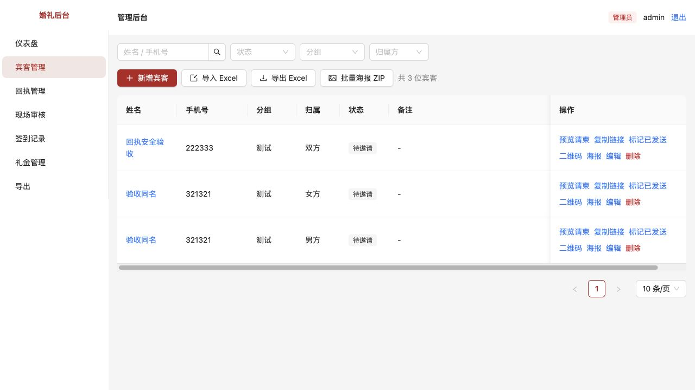

# 本地请柬链接指向示例域名

[文档索引](../../README.md) · [问题目录](../README.md) · [原始审查报告](../../评审/代码审查与现场审核改进建议.md)

完成日期：2026-10-15。为通用回执隔离功能补齐本地验收入口。

## 原问题怎么复现

管理员在“宾客管理”复制专属请柬链接，打开后地址仍指向 example 示例域名，无法在当前本地环境验收专属回执。

## 修改内容

本地验收入口已补齐：开发配置默认 `PUBLIC_BASE_URL=http://localhost:5173`，管理员在“宾客管理”每一行点击“预览请柬”可直接打开当前网站的专属页面，不依赖公网域名。也可重新点击“复制链接”，应得到 localhost 地址。原来复制的 example 地址需重新复制；婚礼姓名、图片仍是演示素材，不影响回执功能验收。以后正式部署时，把 PUBLIC_BASE_URL 改为自己的 HTTPS 域名。

## 怎么验收

先按[本地开发与验收](../../技术/本地开发与验收.md)启动项目。修改环境配置后需重启开发服务。

| 操作 | 预期结果 |
| --- | --- |
| 管理员打开“宾客管理”，点击某位宾客的“预览请柬” | 打开当前网站的专属请柬，地址含该宾客的邀请凭证 |
| 重新点击“复制链接”，粘贴到地址栏 | 默认本地环境下以 http://localhost:5173 开头，不再指向 example |
| 打开该链接，填写专属回执 | 后台对应宾客出现来源为“专属”的回执 |

若使用其他端口或地址，请把 `PUBLIC_BASE_URL` 设置为浏览器实际能访问的前端地址，再重启服务并重新复制链接。

## 验证记录

已在本地浏览器验证专属请柬入口。完整的专属、通用回执隔离验收见[第2项](../02-通用回执覆盖专属回执/README.md)。

