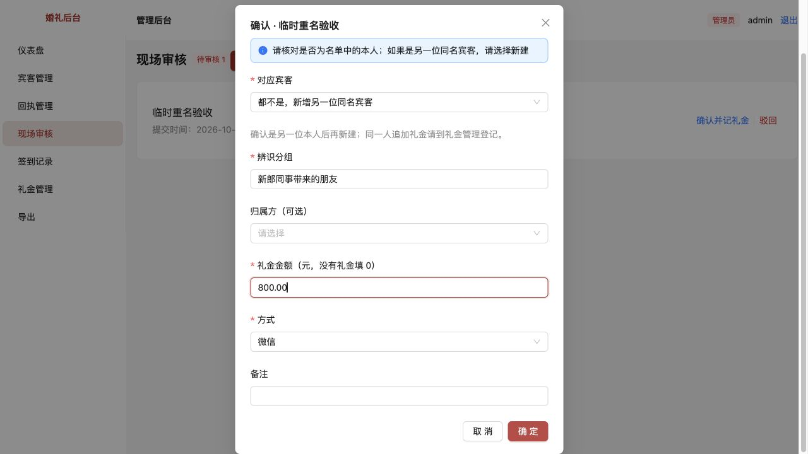
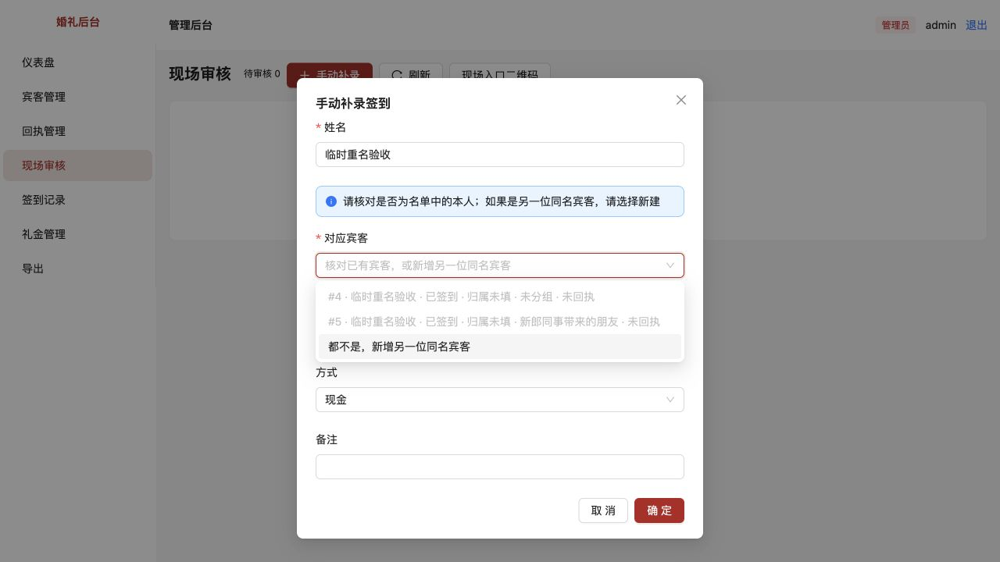
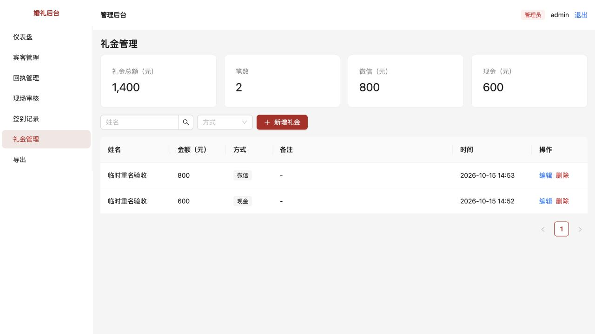

# 现场临时宾客重名无法登记

[文档索引](../../README.md) · [问题目录](../README.md) · [验收环境](../../技术/本地开发与验收.md)

完成日期：2026-10-15。已修复并通过自动测试与浏览器验证，待用户验收。本项修正[第3项](../03-重复签到与重复记账/README.md)中把新标识同名提交直接视为同一个人的规则。

## 原问题怎么复现

1. 在现场补录一位名单外宾客，例如“临时重名验收”，登记600元礼金。
2. 另一位同名临时宾客扫码提交，或请工作人员补录。
3. 修复前：自助页直接返回前一位的“已完成签到”；补录界面只有已签到的候选且不允许保存，没有当场新建另一位同名宾客的入口。

## 修改内容

- 同一次提交标识的刷新、重复点击、网络重试继续复用原记录；不同标识的同名提交各自进入待审，不复用他人的签到状态。
- 审核与手动补录的“对应宾客”始终允许选择“都不是，新增另一位同名宾客”，即使只有一位同名候选、或所有候选均已签到。
- 有候选时必须明确选择；已签到候选不可选择。新建另一人须填写辨识分组（1–50字），例如“新郎同事带来的朋友”，可选归属方。之后同名候选显示该分组及独立编号。
- 新建档案、签到、礼金在同一事务中保存，礼金绑定新宾客ID；礼金写入失败整体回滚。新建操作只允许登录后的管理员或工作人员执行。
- 同一宾客ID仍不可再次确认签到；同次手动补录重试不会反复新建档案。新建与选择已有宾客不能同时提交。
- 无需新增迁移；保留原有签到、礼金和提交映射。旧标识仍返回原记录，要替另一人登记请点击“为另一位宾客登记”。

## 怎么验收

重启开发服务并刷新签到、现场审核页面，建议使用[独立验收数据库](../../技术/本地开发与验收.md)。测试使用一个尚未使用过的姓名。

| 操作 | 应看到的结果 |
| --- | --- |
| 手动补录名单外姓名，登记600元 | 创建第一位宾客，1条签到、1笔600元 |
| 另一设备扫码输入同名；同浏览器则点击“为另一位宾客登记”再输入同名 | 自助页显示“已提交”，后台增加独立待审，不冒用第一位的已签到状态 |
| 审核第二条，展开“对应宾客” | 第一位显示已签到且不可选；可选“都不是，新增另一位同名宾客” |
| 选择新建，不填辨识分组直接确认 | 必填提示，不能保存 |
| 填“新郎同事带来的朋友”，礼金800元，确认 | 新建第二位同名宾客，独立签到和800元礼金，第一位600元不变 |
| 再打开手动补录并输入同名 | 两位均显示独立编号与已签到状态，第二位显示新填的分组；仍保留新增入口 |
| 刷新第二位自助页，重新提交原姓名 | 使用原标识，返回该次已完成签到，不增加第三条签到或礼金 |
| 新设备再次同名提交，尝试关联到已签到者 | 可以待审，但已有宾客不能重复确认；工作人员应核对并驳回误提交 |

不需要工作人员先离开现场审核、去宾客管理预建第二位档案。同一位本人追加礼金应到礼金管理登记，不应使用“新增另一位”绕过重复签到保护。

## 验证结果

- 调整此前按姓名去重的断言，新增临时同名审核建档与礼金归属、手动新建与重试、辨识信息校验与登录权限、建档写失败回滚4项回归测试。修改前测试失败，修改后全项目44项测试通过。
- 类型检查、生产构建通过；构建保留既有的大图表分块提示。
- 浏览器使用独立临时数据库、独立端口：第一位手动600元，第二位扫码进入待审，空辨识分组被阻止，填写后审核800元成功；补录候选显示两个已签到的独立编号与新增入口。
- 独立库核对：宾客#4关联签到#1和60000分，宾客#5关联签到#2和80000分。未向正常业务库写入测试数据。

## 验收截图

## 使用边界

不同设备或清空浏览器存储后，系统无法只凭姓名证明是同一个人，所以可能多一条待审；重复确认同一宾客ID仍会被拦截。“新增另一位”需要工作人员核实确为不同的人，分组是辨识提示，不是身份凭证。历史误绑或重复账目不自动改写。
