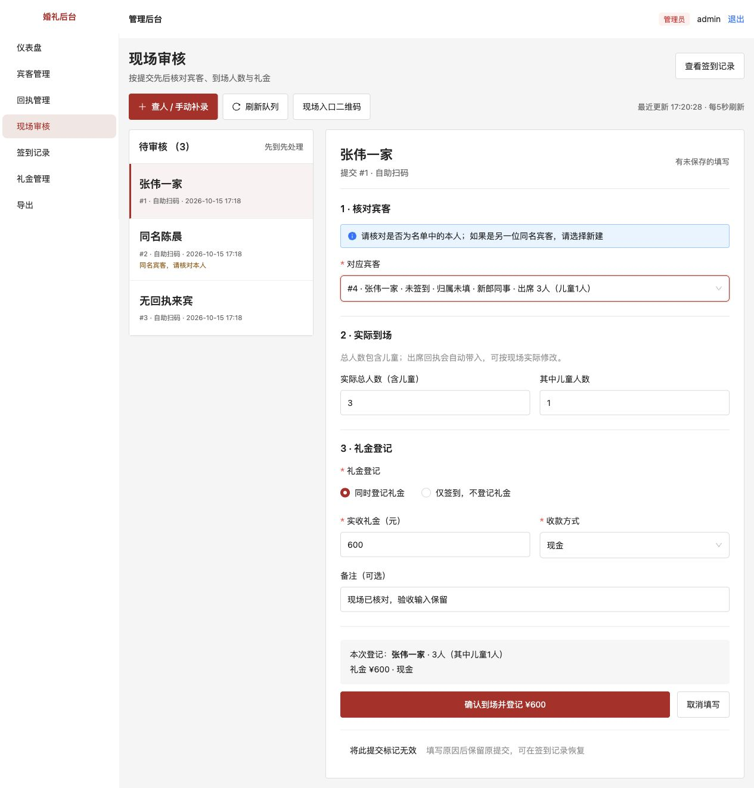
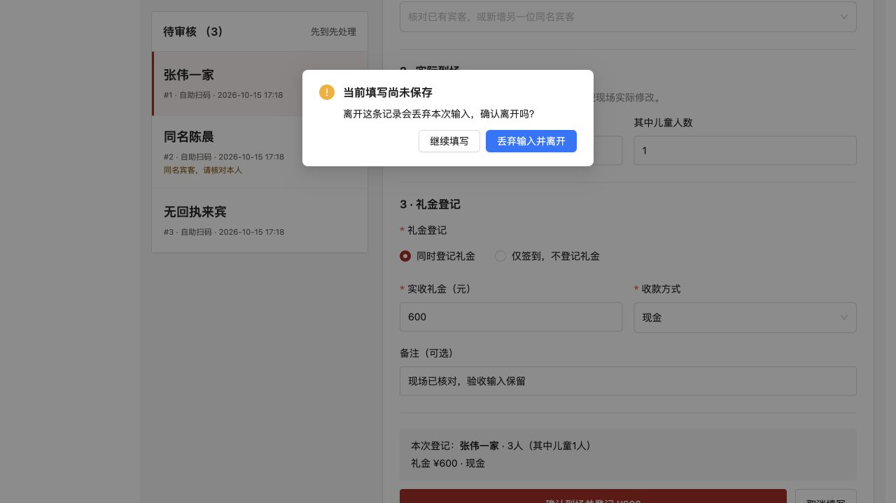
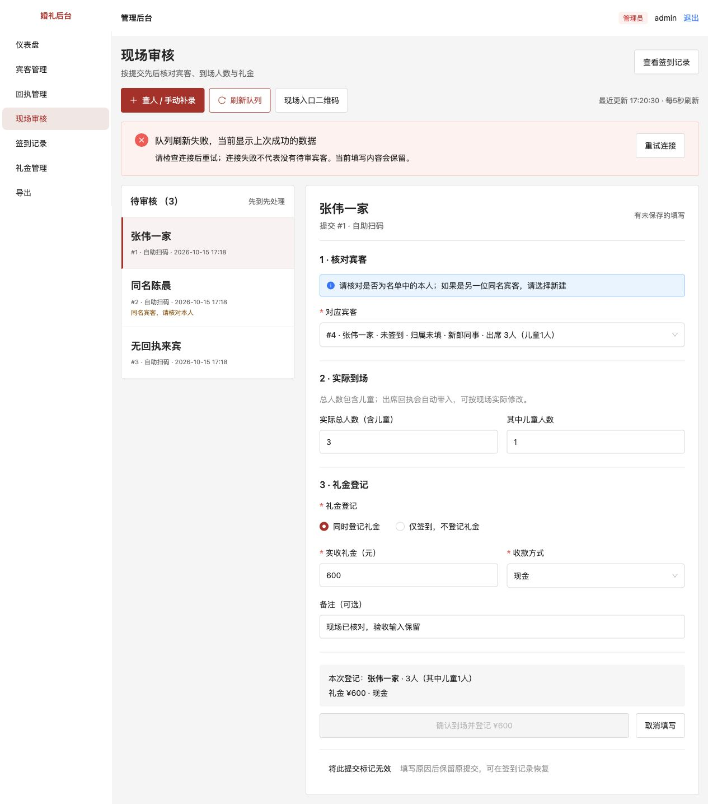
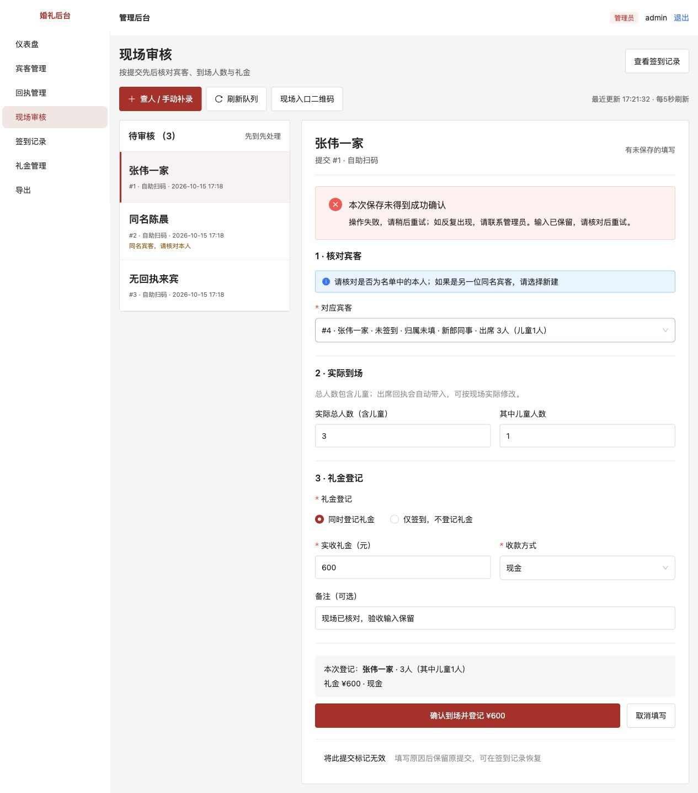
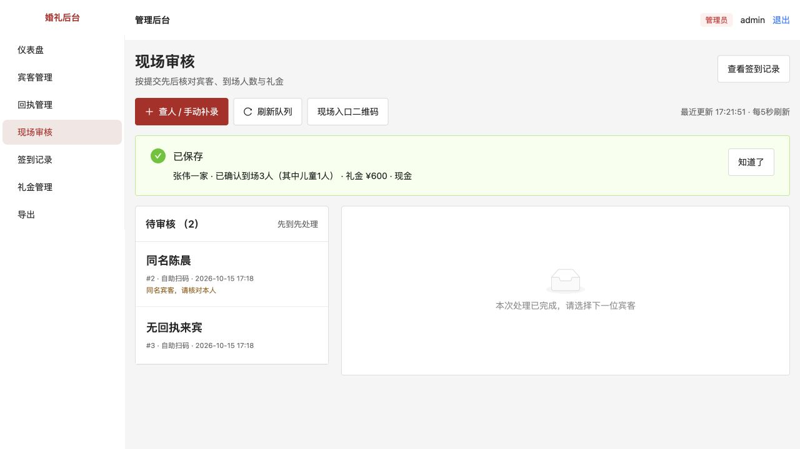
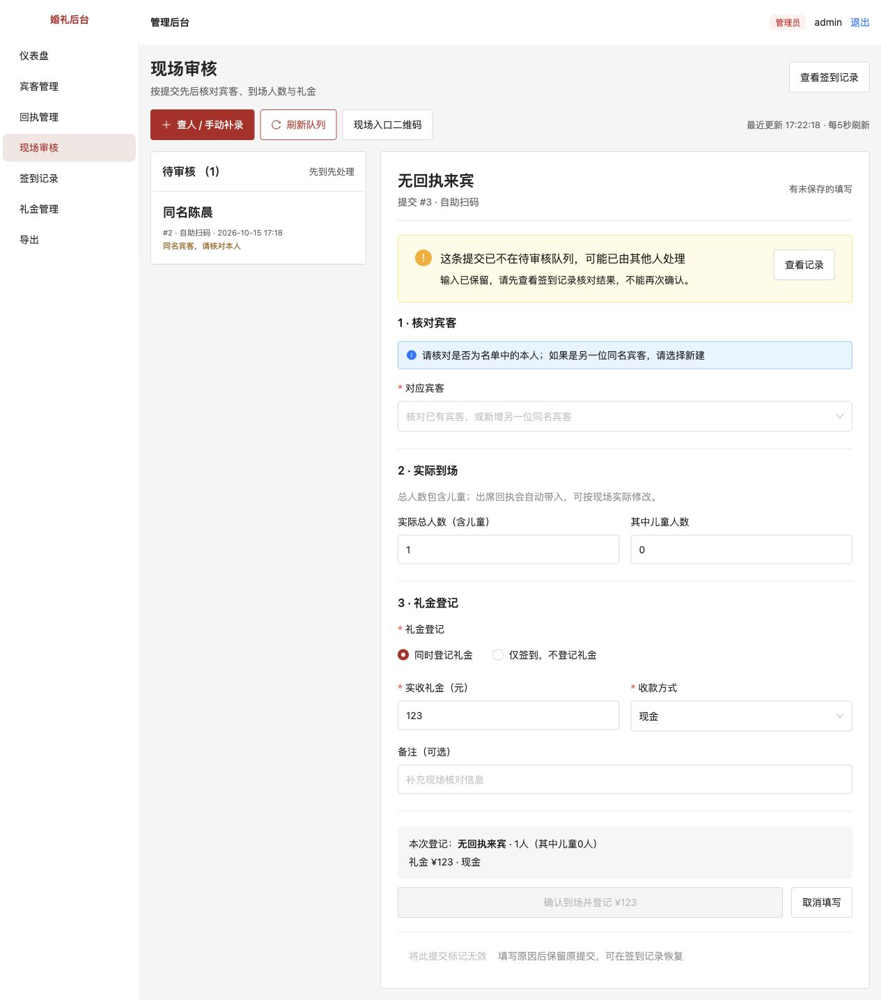
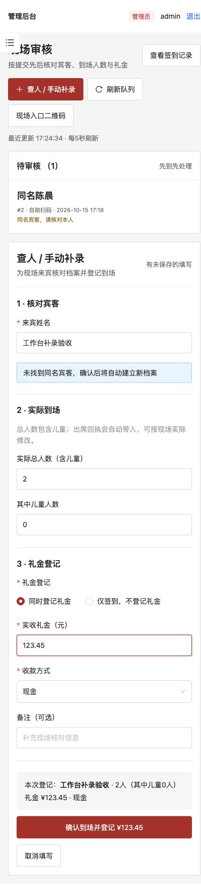
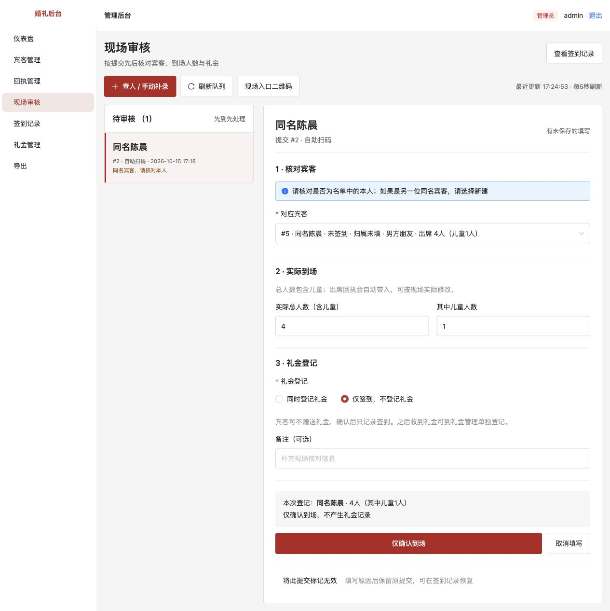
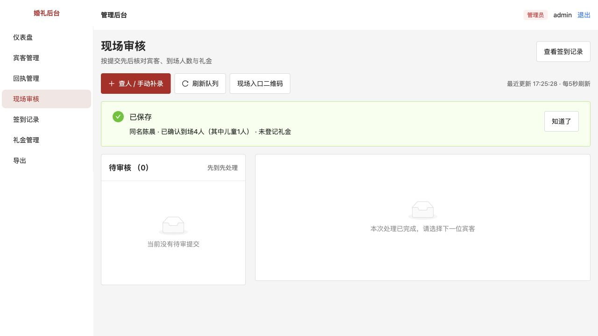

# 现场审核工作台与平面化界面

[返回问题索引](../README.md) · [审查报告与现场流程建议](../../评审/代码审查与现场审核改进建议.md)

状态：用户验收通过（2026-10-15）。本项不新增数据库迁移。

## 原问题怎么复现

- 现场审核原来是姓名列表，点击“确认签到”后弹窗填写，保存后关闭。核对姓名、回执、人数和礼金时需要在列表与弹窗之间来回切换。
- 待审按最新提交倒序，新记录不断插到队头，先来的宾客容易一直往后排。
- `pending.data ?? []` 同时用于请求失败和真正空队列，连接失败也可能显示“暂无待审核提交”。
- 切换宾客或离开页面没有输入保护；失败时还会清空选择，可能连带改变已核对的人数。
- “确定”按钮没有说明本次确认几人、是否登记礼金，保存成功也缺少完整结果核对。

## 本次调整

### 一屏处理现场登记

- 桌面左侧待审核队列、右侧审核工作区；待审按提交时间从早到晚排列，同一时刻按记录编号稳定排序。
- 点击队列里的姓名即可在右侧核对。队列选中状态固定，刷新或新提交不会切走当前填写的宾客。
- “查人 / 手动补录”也在同一工作区完成，不再另开录入弹窗；同名辨认、另一位同名宾客新建、人数、礼金与备注沿用已有业务规则。
- 工作区按“核对宾客 → 实际到场 → 礼金登记”排列。回执人数可自动带入并修改；默认登记礼金、默认现金，仍可改为仅签到。
- 底部实时展示本次姓名、总人数、儿童数、礼金金额和收款方式；按钮明确写“仅确认到场”或“确认到场并登记 ¥金额”。
- 保存成功后保留清晰的结果提示，由工作人员再选择下一位，避免刚保存就被切走而无法核对。
- 低优先级操作放在工作区底部：“将此提交标记无效”仍调用原有影响预览、原因和历史恢复流程。

### 输入与连接防呆

- 显示最近一次成功更新的时分秒，队列每5秒刷新。
- 区分初始加载、加载失败、成功为空和已有数据刷新失败。失败时明确显示旧数据提醒，不暗示当前没有待审宾客。
- 队列确认在连接失败时暂停提交，恢复后继续核对。网络保存未得到成功结果时保留输入，并提示先核对原操作结果。
- 保存失败保留已选宾客、实际人数、金额、方式和备注，不自动清空选择。
- 如果其他工作人员已处理原提交，当前草稿保留，显示“已不在待审核队列”，停止重复确认，并提供查看记录入口。
- 切换队列项、切到补录、取消填写、侧栏导航、工作台记录入口或退出前，若有未保存输入，会先询问丢弃还是继续填写。保存期间禁止切走。
- 浏览器刷新、关闭注册了未保存提示；具体弹窗行为由浏览器控制。草稿只保留在当前页面内存中，不属于离线持久草稿；浏览器历史前进后退未纳入本项侧栏导航保护。
- 审核和补录分别监听各自表单，避免模式切换后底部预览仍读取另一张表单的数据。

### 平面化和窄屏

- 现场工作区使用白底、浅灰分区、细边线、小圆角，移除原列表与录入弹窗的嵌套卡片。
- 姓名放大，主要操作有明确文字，按钮至少44px高。人数并排、金额与收款方式并排，减少重复说明。
- 窄屏改为单列，队列限制高度，字段与操作按钮自适应；本轮为网页窄屏测试，不替代微信真机验收。
- 本项只调整现场工作台，不表示其他管理页面的主题与查询失败提示已经全部统一。

## 如何验收

重启 `pnpm dev` 并刷新页面，进入“现场审核”。使用测试宾客验收，礼金是真实账目时请不要随意试填金额。

1. **队列顺序**：先后用不同姓名提交两次签到，先提交的记录应排前。同一记录选中后，等待一次自动刷新或点击“刷新队列”，选中人不变。
2. **直观核对**：点击左侧姓名，右侧直接显示表单。已有回执的唯一宾客自动带入人数；同名多人先选对应宾客，再带入各自人数。
3. **默认值与预览**：默认“同时登记礼金”、收款方式“现金”。填600后，底部应显示本次人数、600元及现金，主按钮包含金额；切换“仅签到”后，不再要求金额或方式，主按钮改为“仅确认到场”。
4. **未保存提醒**：填写金额或备注后，点击另一位、手动补录、取消填写、侧栏菜单或退出，应出现未保存提醒。选“继续填写”，原姓名、人数、金额和备注全部保留。选丢弃后才切走。
5. **刷新保留**：填写途中点击“刷新队列”，人数、选择、金额和备注不应重置，新提交也不应抢占当前工作区。
6. **连接失败**：在可控开发环境中暂时停止后端，保持当前页面不要刷新整页，点击“刷新队列”或等待轮询。应明确提示刷新失败、显示上次成功数据，并保留表单；重新启动后端后可恢复。
7. **多人处理**：两个浏览器打开同一条待审，一端保存后，另一端刷新队列。另一端应保留输入并提示已被处理，确认按钮不可重复点击；到签到记录核对结果。
8. **保存反馈**：正常保存后应显示姓名、实际总人数、儿童数、是否登记礼金及收款方式；队列移除此提交。到签到记录核对，只产生一次确认和对应礼金。
9. **手动补录**：切换到“查人 / 手动补录”，填测试姓名、人数2、金额123.45，默认现金。预览和按钮必须同步显示2人及123.45元；保存结果与签到记录一致。
10. **窄屏**：缩窄浏览器或用手机访问，队列与表单应转为单列，页面无需横向拖动，输入及保存按钮可正常操作。

## 实际验证

- 91项自动测试通过，新增队列按时间及编号稳定排序、排除已处理记录的集成测试；原有同名匹配、幂等、回执人数、权限和事务回滚测试继续通过。
- 类型检查、生产构建、差异空白检查通过。
- 独立验收环境实测：桌面工作区、回执人数带入、默认现金、实时预览、切换及侧栏导航保护、主动刷新保留输入、断开服务时旧数据提示、恢复连接后保留输入。
- 在独立数据库模拟礼金写入失败：原签到仍待审，没有写入礼金，页面保留全部输入。解除模拟故障后原内容重试成功，只生成一次确认及一笔600元现金礼金。
- 模拟另一位工作人员处理当前待审：原输入123元仍可查看，但确认按钮禁用，没有误增礼金。
- 414px窄屏下实测单列布局，页面宽度未超过视口，补录2人、123.45元现金成功。恢复桌面后，同名选择、回执带入及仅签到成功，真正空队列提示正确。
- 终态数据库核对：4条已确认签到、实际10人；2笔现金礼金，分别60000分和12345分。无重复写入。
- 全部故障模拟与登记均发生在独立验收数据库，没有写入业务数据库。

## 截图

